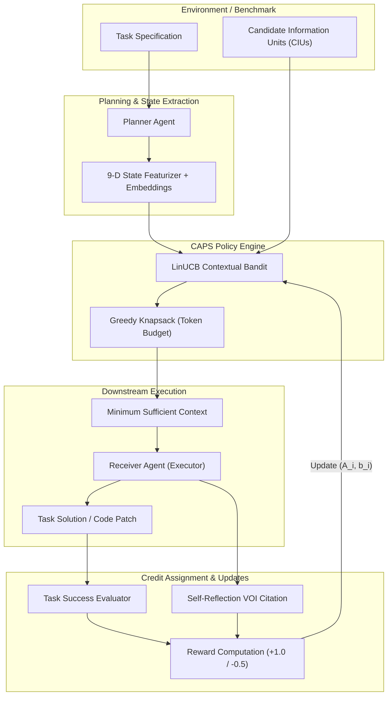

# CAPS: Communication-Adaptive Policy System
### *Learning Adaptive Communication Policies for Efficient Multi-Agent LLM Collaboration*

[](https://www.python.org/)
[](https://opensource.org/licenses/MIT)
[]()
[](https://github.com/astral-sh/ruff)
[]()

---

## 📌 Executive Summary

Modern multi-agent LLM systems (e.g., Planner $\to$ Worker/Receiver architectures) face a critical bottleneck: **the over-communication dilemma**. Transmitting exhaustive context (full codebases, complete execution logs, environment dumps) across agent boundaries leads to:

1. **Quadratic Token Cost & Latency Inflation**: Escalating inference overhead per task episode.
2. **Attention Dilution & Distraction**: Large language models exhibit *"lost-in-the-middle"* degradation and become distracted by redundant or conflicting snippets.
3. **Budget Exhaustion**: In real-world constrained environments, transmitting everything is simply infeasible.

**CAPS (Communication-Adaptive Policy System)** is a research framework and reinforcement learning testbed designed to solve this problem. CAPS formalizes context selection as a **contextual bandit problem (LinUCB)**. Instead of relying on static heuristics (e.g., *"always send files first"*) or sending unfiltered context, CAPS learns an adaptive policy that selects the **minimum sufficient context** (measured in Candidate Information Units, or CIUs) required to maximize downstream task success under strict token budgets.

---

## 🔬 Core Innovations

### 1. Candidate Information Units (CIUs)
Context is decoupled into discrete, typed, atomic units of information rather than raw text blobs:
- **Types**: Source code, stack traces, configuration schemas, documentation snippets, test outputs, execution environment states.
- **Properties**: Unique ID, token consumption, semantic representation, and hidden ground-truth utility classes (*Necessary*, *Useful*, *Redundant*, *Misleading*, or *Conditional*).

### 2. Contextual Bandit Policy (LinUCB)
CAPS models context selection via **Linear Upper Confidence Bound (LinUCB)**:
$$\text{UCB}_i = x^\top \theta_i + \alpha \sqrt{x^\top A_i^{-1} x}$$
where:
- $\theta_i = A_i^{-1} b_i$ denotes the estimated ridge regression coefficients for CIU type $i$.
- $\alpha \ge 0$ governs the exploration-exploitation balance.
- $x \in \mathbb{R}^9$ is a context feature vector capturing token budget ratios, task complexity, turns elapsed, and dense semantic embeddings from `all-MiniLM-L6-v2`.

### 3. $O(1)$ Value of Information (VOI) Credit Assignment
Traditional Leave-One-Out (LOO) counterfactual evaluation requires $O(N)$ inference passes per interaction and fails under redundant information. CAPS implements **Self-Reflection Attribution**:
- The Receiver LLM is prompted post-execution to explicitly cite the CIUs it utilized.
- **Credit Assignment**: $+1.0$ reward for selected & utilized CIUs, $-0.5$ penalty for selected but unused/distractor CIUs.
- This provides fine-grained, per-arm credit assignment in a single inference call ($O(1)$).

---

## 🏗️ System Architecture



---

## 📊 Supported Baselines & Methods

| Policy / Baseline | Description | Learning Mechanism |
| :--- | :--- | :--- |
| **`CAPS-VOI`** | Contextual LinUCB with self-reflection VOI credit assignment | Contextual Bandit (Per-CIU Reward) |
| **`CAPS-NoVOI`** | Contextual LinUCB with global episode outcome reward | Contextual Bandit (Global Reward) |
| **`CAPS-OracleVOI`**| Theoretical upper bound using ground-truth labeled utilities | Supervised Oracle Baseline |
| **`FullContext`** | Exhaustive transmission of all available CIUs | Upper bound on cost, unconstrained |
| **`Heuristic`** | Static ranking (BM25 / lexical relevance + static priority) | Non-adaptive Rule Baseline |
| **`LLMPlanner`** | Zero-shot LLM prompt instructed to select relevant context | Prompt-driven Zero-shot |
| **`Random`** | Uniformly random selection within token budget | Lower-bound Control |

---

## 🧪 Benchmarks

1. **`synthetic_v2` Benchmark**:
   - 35 systematically crafted multi-agent tasks spanning **7 failure modes & categories**:
     * Debugging
     * Configuration Tuning
     * Data Transformation
     * Code Repair
     * Documentation Lookup
     * Multi-Hop Reasoning
     * Contradiction Resolution
   - 3 Difficulty Tiers (Easy, Medium, Hard) with planted distractor and redundant CIUs.
2. **`SWE-bench Lite` Adapter**:
   - Real-world Python repository bug resolution with extracted code files, repo trees, and issue reports.

---

## ⚡ Quickstart

### Prerequisites
- Python $\ge$ 3.11
- [Optional] Groq API Key or OpenRouter API Key (Mock mode works out-of-the-box without keys)

### Installation

```bash
# Clone repository
git clone https://github.com/A-R-K-7/caps.git
cd caps

# Create virtual environment
python -m venv .venv
# Windows:
.venv\Scripts\activate
# Linux/macOS:
source .venv/bin/activate

# Install dependencies in editable mode
pip install -e ".[dev]"
```

### Environment Configuration

Create a `.env` file in the root directory:
```bash
cp .env.example .env
```
Add your API credentials (optional if using mock mode):
```env
GROQ_API_KEY=your_groq_api_key
OPENROUTER_API_KEY=your_openrouter_api_key
```

Verify your setup:
```bash
caps doctor
```

---

## 💻 CLI Usage

CAPS features a rich command-line interface built on Typer:

### 1. Initialize Project & Check Setup
```bash
caps init
caps doctor
caps models
```

### 2. Generate Benchmark Datasets
```bash
# Generate 50 synthetic benchmark instances
caps dataset generate --size 50 --seed 42 --output data/synthetic/benchmark.jsonl

# Validate dataset integrity
caps dataset validate data/synthetic/benchmark.jsonl
```

### 3. Run Experiments
```bash
# Run with Mock LLM (Zero API cost, deterministic)
caps experiment run --config configs/caps_synthetic_mock.yaml --seed 42

# Run with Real LLM (Groq / OpenRouter)
caps experiment run --config configs/caps_synthetic.yaml --seed 42
```

### 4. Run Research Pipeline (Paired Train/Val/Test)
```bash
# Execute the paired research pipeline on synthetic_v2
caps research run --config configs/caps_research_mock.yaml
```

### 5. Export and Summarize Results
```bash
# View summary table in console
caps results summarize

# Export metrics to CSV, Markdown, or LaTeX
caps results export --format markdown --output results/summary
caps results export --format latex --output results/summary
```

---

## 🧪 Testing & Verification

CAPS comes with a comprehensive test suite covering core components, policy updates, environment dynamics, and research pipelines:

```bash
# Run all tests
pytest

# Run tests with code coverage report
pytest --cov=caps --cov-report=term-missing
```

---

## 📁 Repository Structure

```text
caps/
├── configs/                       # Experiment & research pipeline YAML configurations
│   ├── caps_research_mock.yaml    # Synthetic-v2 research pipeline (Mock LLM)
│   ├── caps_research_real.yaml    # Synthetic-v2 research pipeline (Groq/Llama-3)
│   ├── caps_synthetic_mock.yaml   # Synthetic benchmark configuration
│   └── default.yaml               # Global system defaults
├── data/                          # Benchmarks & splits (synthetic_v2, SWE-bench)
├── research/                      # Evaluation scripts, results, figures, and defense docs
├── research_audit/                # Detailed mathematical audits, validity checks & manifests
├── research_pilot/                # Pilot study reports, diagnostic traces, and checkpoints
├── src/caps/                      # Core package source
│   ├── agents/                    # Planner, Receiver, and Evaluator agents
│   ├── bandits/                   # LinUCB contextual bandit algorithm implementation
│   ├── communication/             # CIU schemas, policies, selectors, state featurizers
│   ├── datasets/                  # Synthetic generators & SWE-bench adapters
│   ├── embeddings/                # Local sentence-transformers cached embeddings
│   ├── environments/              # Sequential RL interaction environments
│   ├── evaluation/                # Metrics, statistical tests, plotting, reward shaping
│   ├── experiments/               # Experiment orchestrator & execution runners
│   ├── llm/                       # Groq, OpenRouter, and Mock LLM client interfaces
│   ├── research/                  # High-level paired research pipeline runner
│   ├── storage/                   # SQLite database storage & caching layer
│   └── cli.py                     # Typer CLI application entry point
├── tests/                         # Full unit & integration test suite (79 tests)
├── pyproject.toml                 # Package metadata, dependencies, and build config
└── README.md                      # Project documentation
```

---

## 📜 Citation & Research

If you use CAPS in your academic work, please cite:

```bibtex
@article{reddy2026caps,
  title   = {Communication-Adaptive Policy System (CAPS): Learning Adaptive Communication Policies for Efficient Multi-Agent LLM Collaboration},
  author  = {Reddy, K. Akshay},
  year    = {2026},
  url     = {https://github.com/A-R-K-7/caps}
}
```

---

## 📄 License

This project is licensed under the [MIT License](LICENSE).
