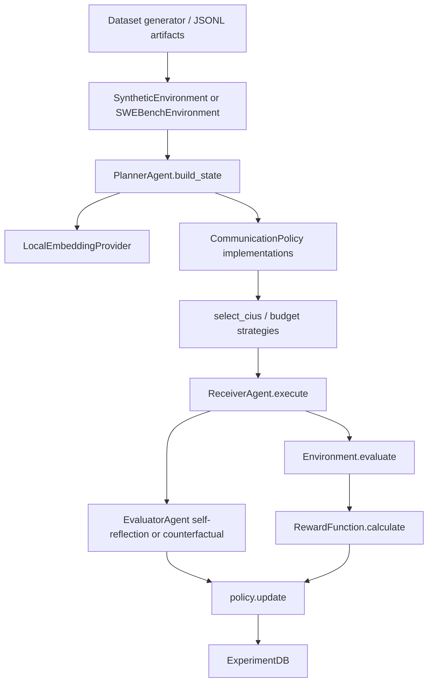

# CAPS Research Evidence Audit

Generated: 2026-09-05T21:04:15

# Executive Summary

Project: CAPS - Communication-Adaptive Policy System.

Research objective: learn/select adaptive communication context for multi-agent LLM collaboration instead of always transmitting all available context. The explicit hypothesis is RECONSTRUCTED FROM IMPLEMENTATION and plan.md: an agent can learn which Candidate Information Units (CIUs) to send to preserve task success while reducing communication cost.

Implementation status: runnable Python package with planner, receiver, evaluator, CIU schema, baselines, LinUCB policy, synthetic and lightweight SWE-bench dataset support, SQLite storage, and CLI. It is a research prototype, not a complete official benchmark harness.

Frameworks/libraries: Python, Pydantic, SQLAlchemy, NumPy, pandas/scipy/scikit-learn/matplotlib, sentence-transformers, Typer/Rich, Tenacity, Groq/OpenAI-compatible clients.

LLM providers: Groq provider and OpenRouter-compatible mode via `base_url`. Mock provider for tests. Gemini is proposed in `plan.md` but not implemented in current source.

Embedding model: configured default `all-MiniLM-L6-v2`; local sentence-transformers embeddings cached in SQLite.

Databases: data\experiments.db, data\experiments_archive.db, data\mock_experiments.db, caps_experiments.db, data\llm_cache.db, data\embedding_cache.db, llm_cache.db, mlflow.db, results.db.

Experiments found: 32 experiment records across available databases. Episode rows found: 2874.

## Current Experimental Status

| Database | Method | Experiment ID | Successful | Completed | API failures | Other failures | Correct success | Mean tokens | Mean latency ms | Mean reward |
| --- | --- | --- | --- | --- | --- | --- | --- | --- | --- | --- |
| data\experiments.db | CAPS | caps_ark_CAPS_42 | 182 | 200 | NOT RECORDED IN EPISODES | 18 | 0.91 | 118.46 | 7950.78 | 0.8519 |
| data\experiments.db | FullContext | caps_ark_FullContext_42 | 184 | 200 | NOT RECORDED IN EPISODES | 16 | 0.92 | 118.46 | 7559.54 | 0.8636 |
| data\experiments.db | Heuristic | caps_ark_Heuristic_42 | 188 | 200 | NOT RECORDED IN EPISODES | 12 | 0.94 | 118.46 | 7602.36 | 0.884 |
| data\experiments.db | LLMPlanner | caps_ark_LLMPlanner_42 | 182 | 200 | NOT RECORDED IN EPISODES | 18 | 0.91 | 83.42 | 16331.19 | 0.8371 |
| data\experiments.db | Random | caps_ark_Random_42 | 185 | 200 | NOT RECORDED IN EPISODES | 15 | 0.925 | 118.46 | 7647.52 | 0.8681 |
| data\experiments.db | CAPS | caps_experiment_CAPS_42 | 162 | 200 | NOT RECORDED IN EPISODES | 38 | 0.81 | 118.46 | 7211.45 | 0.7563 |
| data\experiments.db | CAPS | caps_swe_bench_v1_CAPS_42 | 23 | 50 | NOT RECORDED IN EPISODES | 27 | 0.46 | 1644.96 | 68107.67 | 0.3006 |
| data\experiments.db | CAPS | caps_swe_bench_v1_CAPS_43 | 13 | 50 | NOT RECORDED IN EPISODES | 37 | 0.26 | 1644.96 | 53004.35 | 0.1026 |
| data\experiments.db | CAPS | caps_swe_bench_v1_CAPS_44 | 2 | 50 | NOT RECORDED IN EPISODES | 48 | 0.04 | 1644.96 | 23646.18 | -0.1188 |
| data\experiments.db | CAPS | caps_swe_bench_v1_CAPS_45 | 0 | 9 | NOT RECORDED IN EPISODES | 9 | 0.0 | 1699.56 | 21622.82 | -0.1599 |
| data\experiments.db | CAPS | caps_swe_bench_v1_CAPS_46 | 1 | 25 | NOT RECORDED IN EPISODES | 24 | 0.04 | 1647.28 | 22661.19 | -0.1186 |
| data\experiments.db | CAPS | caps_swe_bench_v1_CAPS_47 | 2 | 50 | NOT RECORDED IN EPISODES | 48 | 0.04 | 596.64 | 15155.51 | -0.0628 |
| data\experiments.db | FullContext | caps_swe_bench_v1_FullContext_42 | 2 | 50 | NOT RECORDED IN EPISODES | 48 | 0.04 | 1644.96 | 12177.72 | -0.0775 |
| data\experiments.db | Heuristic | caps_swe_bench_v1_Heuristic_42 | 3 | 50 | NOT RECORDED IN EPISODES | 47 | 0.06 | 1644.96 | 23394.86 | -0.1002 |
| data\experiments.db | LLMPlanner | caps_swe_bench_v1_LLMPlanner_42 | 25 | 50 | NOT RECORDED IN EPISODES | 25 | 0.5 | 1633.36 | 29427.54 | 0.3335 |
| data\experiments.db | Random | caps_swe_bench_v1_Random_42 | 39 | 50 | NOT RECORDED IN EPISODES | 11 | 0.78 | 1644.96 | 26945.15 | 0.6205 |
| data\experiments.db | CAPS | caps_swe_bench_v2_CAPS_42 | 6 | 50 | NOT RECORDED IN EPISODES | 44 | 0.12 | 1162.04 | 17440.11 | -0.011 |
| data\experiments.db | FullContext | caps_swe_bench_v2_FullContext_42 | 47 | 50 | NOT RECORDED IN EPISODES | 3 | 0.94 | 1644.96 | 28565.59 | 0.7764 |
| data\experiments.db | Heuristic | caps_swe_bench_v2_Heuristic_42 | 7 | 50 | NOT RECORDED IN EPISODES | 43 | 0.14 | 1644.96 | 23091.57 | -0.0211 |
| data\experiments.db | LLMPlanner | caps_swe_bench_v2_LLMPlanner_42 | 8 | 50 | NOT RECORDED IN EPISODES | 42 | 0.16 | 1624.96 | 80701.02 | -0.006 |
| data\experiments.db | Random | caps_swe_bench_v2_Random_42 | 25 | 50 | NOT RECORDED IN EPISODES | 25 | 0.5 | 1644.96 | 22721.3 | 0.3451 |
| data\experiments.db | CAPS | caps_swe_bench_v3_CAPS_42 | 2 | 50 | NOT RECORDED IN EPISODES | 48 | 0.04 | 828.6 | 50901.75 | -0.0866 |
| data\experiments.db | FullContext | caps_swe_bench_v3_FullContext_42 | 1 | 50 | NOT RECORDED IN EPISODES | 49 | 0.02 | 1644.96 | 56701.21 | -0.1458 |
| data\experiments.db | Heuristic | caps_swe_bench_v3_Heuristic_42 | 1 | 50 | NOT RECORDED IN EPISODES | 49 | 0.02 | 1644.96 | 67964.01 | -0.1458 |
| data\experiments.db | LLMPlanner | caps_swe_bench_v3_LLMPlanner_42 | 3 | 50 | NOT RECORDED IN EPISODES | 47 | 0.06 | 1642.96 | 68168.72 | -0.1057 |
| data\experiments.db | Random | caps_swe_bench_v3_Random_42 | 2 | 50 | NOT RECORDED IN EPISODES | 48 | 0.04 | 1644.96 | 66742.92 | -0.1258 |
| data\experiments.db | CAPS | caps_swe_bench_v3_full_dataset_CAPS_42 | 1 | 300 | NOT RECORDED IN EPISODES | 299 | 0.0033 | 225.84 | 64213.13 | -0.1057 |
| data\experiments.db | LLMPlanner | caps_swe_bench_v3_full_dataset_LLMPlanner_42 | 37 | 240 | NOT RECORDED IN EPISODES | 203 | 0.1542 | 1590.02 | 42875.3 | -0.0099 |
| data\mock_experiments.db | CAPS | caps_synthetic_mock_CAPS_42 | 0 | 50 | NOT RECORDED IN EPISODES | 50 | 0.0 | 118.52 | 4.34 | -0.006 |
| data\mock_experiments.db | FullContext | caps_synthetic_mock_FullContext_42 | 0 | 50 | NOT RECORDED IN EPISODES | 50 | 0.0 | 118.52 | 270.24 | -0.0077 |
| data\mock_experiments.db | Heuristic | caps_synthetic_mock_Heuristic_42 | 0 | 50 | NOT RECORDED IN EPISODES | 50 | 0.0 | 118.52 | 1.31 | -0.0059 |
| data\mock_experiments.db | Random | caps_synthetic_mock_Random_42 | 0 | 50 | NOT RECORDED IN EPISODES | 50 | 0.0 | 118.52 | 1.63 | -0.0059 |


# Implementation Architecture Audit



## Components

Component: Planner. File: `src/caps/agents/planner.py:41`. Class: `PlannerAgent`. Function: `build_state`, `plan_with_llm`. Input: task string, CIUs, budget, metadata. Output: `CommunicationState` or `PlannerOutput`. Purpose: embed task/CIUs and construct policy state; LLM planning exists for raw context but the experiment runner uses `build_state`.

Component: Receiver. File: `src/caps/agents/receiver.py:40`. Class: `ReceiverAgent`. Function: `execute`. Input: task and selected CIUs only. Output: `ReceiverOutput`. Purpose: solve task using selected context and self-report used CIUs/missing info.

Component: Evaluator. File: `src/caps/agents/evaluator.py:21`. Class: `EvaluatorAgent`. Functions: `evaluate_voi`, `evaluate_self_reflection`. Input: selected CIUs, receiver output, success, environment. Output: per-CIU VOI scores. Purpose: provide policy update signal.

Component: CIU schema. File: `src/caps/communication/ciu.py:17`. Class: `CIU`. Input/Output: Pydantic object. Purpose: represent atomic context.

Component: State/action. File: `src/caps/communication/state.py:20`. Classes: `CommunicationState`, `Action`. Purpose: policy observation and selected CIU IDs/scores.

Component: LinUCB. File: `src/caps/bandits/linucb.py:47`. Class: `LinUCBPolicy`. Purpose: CAPS learning policy.

Component: Reward. File: `src/caps/evaluation/reward.py:24`. Class: `RewardFunction`. Purpose: task success minus weighted normalized communication cost.

Component: Database. File: `src/caps/storage/database.py:37`. Classes: SQLAlchemy records and `ExperimentDB`. Purpose: store experiments, episodes, metrics, nominal LLM calls.

Component: API layer. File: `src/caps/llm/groq_client.py:28`. Class: `GroqProvider`. Purpose: Groq/OpenRouter-compatible chat completions, retries, rate-limit handling, key switching, model fallback.


# Mathematical Formulation

Implemented CAPS policy uses a per-CIU-type contextual LinUCB model.

Context vector actually used by `LinUCBPolicy._build_context` is 9-dimensional:

`x = [token_budget/10000 clipped to 1, planner_confidence, previous_turns/5 clipped to 1, ciu_tokens/2000 clipped to 1, ciu.priority, ciu.historical_utility, ciu.historical_selection_rate, ciu.uncertainty, cosine(task_embedding, ciu.embedding)]`

The raw task embedding, receiver embedding/capability, receiver historical success, latency budget, task category, and difficulty exist in schemas but are not part of the LinUCB feature vector.

For each CIU type arm `t`, initialized with `A_t = I`, `b_t = 0`:

`theta_t = A_t^{-1} b_t`

`UCB_t(x) = x^T theta_t + alpha * sqrt(x^T A_t^{-1} x)`

Selected CIUs are greedily chosen by descending score subject to token budget and positive score. The selected list is then reversed, preserving neither original dataset order nor pure descending order in the returned action.

Update for each selected CIU:

`A_t <- A_t + x x^T`

`b_t <- b_t + r_i x`

where `r_i = reward` unless VOI is available; if VOI exists then `r_i = (voi_i + reward) / 2`.

Reward:

`R = 1[success] - lambda * (w_tokens * min(tokens_used/token_budget,1) + w_latency * min(latency_ms/max_latency_ms,1) + w_clarification * min(clarification_turns/max_clarification,1) + w_retries * min(retry_count/max_retries,1))`


# CIU Representation

CIU fields: `id`, `type`, `content`, `source`, `token_count`, `embedding`, `priority`, `historical_utility`, `historical_selection_rate`, `uncertainty`, `metadata`. IDs in generated datasets are deterministic task-prefixed IDs such as `<task_id>_ciu_desc`; default ad hoc CIU IDs are 8-character UUID prefixes.

Token counting uses provided `token_count` when positive; otherwise `max(1, len(content)//4)`. Embeddings are optional lists of floats populated by `LocalEmbeddingProvider`.

# CAPS Policy Audit

# Mathematical Formulation

Implemented CAPS policy uses a per-CIU-type contextual LinUCB model.

Context vector actually used by `LinUCBPolicy._build_context` is 9-dimensional:

`x = [token_budget/10000 clipped to 1, planner_confidence, previous_turns/5 clipped to 1, ciu_tokens/2000 clipped to 1, ciu.priority, ciu.historical_utility, ciu.historical_selection_rate, ciu.uncertainty, cosine(task_embedding, ciu.embedding)]`

The raw task embedding, receiver embedding/capability, receiver historical success, latency budget, task category, and difficulty exist in schemas but are not part of the LinUCB feature vector.

For each CIU type arm `t`, initialized with `A_t = I`, `b_t = 0`:

`theta_t = A_t^{-1} b_t`

`UCB_t(x) = x^T theta_t + alpha * sqrt(x^T A_t^{-1} x)`

Selected CIUs are greedily chosen by descending score subject to token budget and positive score. The selected list is then reversed, preserving neither original dataset order nor pure descending order in the returned action.

Update for each selected CIU:

`A_t <- A_t + x x^T`

`b_t <- b_t + r_i x`

where `r_i = reward` unless VOI is available; if VOI exists then `r_i = (voi_i + reward) / 2`.

Reward:

`R = 1[success] - lambda * (w_tokens * min(tokens_used/token_budget,1) + w_latency * min(latency_ms/max_latency_ms,1) + w_clarification * min(clarification_turns/max_clarification,1) + w_retries * min(retry_count/max_retries,1))`

## Does CAPS Actually Learn?

| experiment_id | episodes | mean_reward_first_half | mean_reward_second_half | mean_tokens_first_half | mean_tokens_second_half | evidence |
| --- | --- | --- | --- | --- | --- | --- |
| caps_swe_bench_v1_CAPS_42 | 50 | 0.3997622755071004 | 0.20147291212819418 | 1647.28 | 1642.64 | Episode rows do not store A/b/theta/UCB scores, so matrix-level policy change is NOT AVAILABLE. Selection/reward trends are observational only. |
| caps_swe_bench_v1_CAPS_43 | 50 | 0.24180683422292074 | -0.036648764126078294 | 1647.28 | 1642.64 | Episode rows do not store A/b/theta/UCB scores, so matrix-level policy change is NOT AVAILABLE. Selection/reward trends are observational only. |
| caps_swe_bench_v1_CAPS_44 | 50 | -0.15670082727864584 | -0.08083119191385907 | 1647.28 | 1642.64 | Episode rows do not store A/b/theta/UCB scores, so matrix-level policy change is NOT AVAILABLE. Selection/reward trends are observational only. |
| caps_swe_bench_v1_CAPS_45 | 9 | -0.14480269956588745 | -0.171968 | 1575.0 | 1799.2 | Episode rows do not store A/b/theta/UCB scores, so matrix-level policy change is NOT AVAILABLE. Selection/reward trends are observational only. |
| caps_swe_bench_v1_CAPS_46 | 25 | -0.15356376579708525 | -0.08633162279862625 | 1660.5833333333333 | 1635.0 | Episode rows do not store A/b/theta/UCB scores, so matrix-level policy change is NOT AVAILABLE. Selection/reward trends are observational only. |
| caps_swe_bench_v1_CAPS_47 | 50 | -0.0619733350845337 | -0.06369715006663006 | 632.24 | 561.04 | Episode rows do not store A/b/theta/UCB scores, so matrix-level policy change is NOT AVAILABLE. Selection/reward trends are observational only. |
| caps_experiment_CAPS_42 | 200 | 0.6355918623936971 | 0.8769561409657796 | 116.39 | 120.53 | Episode rows do not store A/b/theta/UCB scores, so matrix-level policy change is NOT AVAILABLE. Selection/reward trends are observational only. |
| caps_ark_CAPS_42 | 200 | 0.8545848842474619 | 0.8492225452130636 | 116.39 | 120.53 | Episode rows do not store A/b/theta/UCB scores, so matrix-level policy change is NOT AVAILABLE. Selection/reward trends are observational only. |
| caps_swe_bench_v2_CAPS_42 | 50 | -0.040130275223795586 | 0.018114283437601703 | 1018.16 | 1305.92 | Episode rows do not store A/b/theta/UCB scores, so matrix-level policy change is NOT AVAILABLE. Selection/reward trends are observational only. |
| caps_swe_bench_v3_CAPS_42 | 50 | -0.1256776398203532 | -0.0474224 | 971.64 | 685.56 | Episode rows do not store A/b/theta/UCB scores, so matrix-level policy change is NOT AVAILABLE. Selection/reward trends are observational only. |
| caps_swe_bench_v3_full_dataset_CAPS_42 | 300 | -0.10469733333333334 | -0.10670346666666668 | 284.1 | 167.58666666666667 | Episode rows do not store A/b/theta/UCB scores, so matrix-level policy change is NOT AVAILABLE. Selection/reward trends are observational only. |
| caps_synthetic_mock_CAPS_42 | 50 | -0.005876967994689942 | -0.006032939046223959 | 116.84 | 120.2 | Episode rows do not store A/b/theta/UCB scores, so matrix-level policy change is NOT AVAILABLE. Selection/reward trends are observational only. |

Policy checkpoints/A matrices/b vectors/theta values were not found in persisted experiment artifacts. Unit tests show parameters can change, but recorded experiments do not store enough state to verify matrix-level learning after the fact.


# VOI Audit

VOI is implemented in two ways:

Counterfactual replay: for up to `max_counterfactuals` selected CIUs, remove one CIU, rerun the receiver, evaluate success, then assign +1 when removal changes success to failure, -1 when removal changes failure to success, else 0.

Self-reflection: if original task succeeds, selected CIUs self-reported by the receiver receive +1 and other selected CIUs receive 0. If original task fails, all selected CIUs receive 0. The code comment mentions a harsh negative penalty but the implementation uses neutral 0 on failures.

The main runner uses counterfactual VOI only when `config.evaluator.counterfactual` is true and only for CAPS. Current SWE-bench configs set counterfactual false, so they use self-reflection. `default.yaml` also sets counterfactual false; `caps_synthetic.yaml` sets counterfactual true.

VOI is used to update LinUCB only for CAPS via `policy.update(..., voi_scores=voi_scores)`.


# Counterfactual Audit

Counterfactual replay is implemented but not comprehensively persisted. Episode rows store only the resulting `voi_scores` JSON dictionary, not individual counterfactual executions, receiver outputs, or counterfactual success values.

Selection strategy implementation: if selected CIU count is less than or equal to `max_counterfactuals`, test all selected CIUs; otherwise use random sampling. Config may say `uncertainty`, but `_select_for_testing` falls back to random for non-random strategies.

Actual number of counterfactual executions cannot be reconstructed exactly from DB rows without LLM call logs. Counterfactual raw table: NOT AVAILABLE.


# Dataset Audit

| Dataset | Version | Source | Number of tasks | Categories | CIUs mean | CIUs min | CIUs max |
| --- | --- | --- | --- | --- | --- | --- | --- |
| data\synthetic\my_benchmark.jsonl | file artifact | generator or saved JSONL | 100 | {'data_transformation': 20, 'documentation': 20, 'debugging': 20, 'code_repair': 20, 'configuration': 20} | 6.0 | 6 | 6 |
| data\synthetic\swe_bench_lite.jsonl | file artifact | generator or saved JSONL | 300 | {'software_engineering': 300} | 3.0 | 3 | 3 |
| data\synthetic\synthetic_v1.jsonl | file artifact | generator or saved JSONL | 200 | {'configuration': 40, 'documentation': 40, 'data_transformation': 40, 'code_repair': 40, 'debugging': 40} | 6.0 | 6 | 6 |

SWE-bench implementation: `src/caps/datasets/swe_bench.py` loads `princeton-nlp/SWE-bench_Lite` test split through HuggingFace, shuffles by seed, selects up to the requested count, fetches up to three modified files from GitHub, and stores the gold patch in ground truth. It does not run official SWE-bench tests.

## Examples from data\synthetic\my_benchmark.jsonl

```json
[
  {
    "task_id": "data_transformation_002_s42",
    "category": "data_transformation",
    "task": "Write a function to convert a list of dicts to CSV format.",
    "ciu_examples": [
      {
        "id": "data_transformation_002_s42_ciu_sample",
        "type": "sample_data",
        "token_count": 21,
        "content_excerpt": "[{'name': 'Alice', 'age': 30, 'city': 'NYC'}, {'name': 'Bob', 'age': 25, 'city': 'LA'}]"
      },
      {
        "id": "data_transformation_002_s42_ciu_schema",
        "type": "schema",
        "token_count": 32,
        "content_excerpt": "Input: List[Dict[str, Any]]\nExample: [{'name': 'Alice', 'age': 30}, {'name': 'Bob', 'age': 25}]\nOutput: CSV string with header row"
      },
      {
        "id": "data_transformation_002_s42_ciu_unrelated",
        "type": "irrelevant_documentation",
        "token_count": 17,
        "content_excerpt": "# Data Pipeline Architecture\nWe use Apache Airflow for orchestration."
      }
    ]
  },
  {
    "task_id": "data_transformation_001_s42",
    "category": "data_transformation",
    "task": "Write a function to flatten a nested JSON object.",
    "ciu_examples": [
      {
        "id": "data_transformation_001_s42_ciu_unrelated",
        "type": "irrelevant_documentation",
        "token_count": 11,
        "content_excerpt": "# JSON Schema Specification\nVersion: draft-07"
      },
      {
        "id": "data_transformation_001_s42_ciu_env",
        "type": "environment",
        "token_count": 10,
        "content_excerpt": "Python 3.11, no external libraries allowed"
      },
      {
        "id": "data_transformation_001_s42_ciu_constraints",
        "type": "constraints",
        "token_count": 11,
        "content_excerpt": "Handle lists by indexing: key.0, key.1, etc."
      }
    ]
  }
]
```

## Examples from data\synthetic\swe_bench_lite.jsonl

```json
[
  {
    "task_id": "sympy__sympy-17139",
    "category": "software_engineering",
    "task": "Fix this issue:\nsimplify(cos(x)**I): Invalid comparison of complex I (fu.py)\n```\r\n>>> from sympy import *\r\n>>> x = Symbol('x')\r\n>>> print(simplify(cos(x)**I))\r\nTraceback (most recent call last):\r\n  File \"<stdin>\", line 1, in <module>\r\n  File \"/home/e/se/sympy/simplify/simplify.py\", line 587, in simp",
    "ciu_examples": [
      {
        "id": "sympy__sympy-17139_ciu_desc",
        "type": "task_description",
        "token_count": 479,
        "content_excerpt": "simplify(cos(x)**I): Invalid comparison of complex I (fu.py)\n```\r\n>>> from sympy import *\r\n>>> x = Symbol('x')\r\n>>> print(simplify(cos(x)**I))\r\nTraceback (most recent call last):\r\n"
      },
      {
        "id": "sympy__sympy-17139_ciu_fu.py",
        "type": "source_code",
        "token_count": 1254,
        "content_excerpt": "# File: sympy/simplify/fu.py\n\"\"\"\nImplementation of the trigsimp algorithm by Fu et al.\n\nThe idea behind the ``fu`` algorithm is to use a sequence of rules, applied\nin what is heuri"
      },
      {
        "id": "sympy__sympy-17139_ciu_distractor",
        "type": "irrelevant_documentation",
        "token_count": 20,
        "content_excerpt": "This is unrelated documentation. It does not help solve the issue."
      }
    ]
  },
  {
    "task_id": "sympy__sympy-23191",
    "category": "software_engineering",
    "task": "Fix this issue:\ndisplay bug while using pretty_print with sympy.vector object in the terminal\nThe following code jumbles some of the outputs in the terminal, essentially by inserting the unit vector in the middle -\r\n```python\r\nfrom sympy import *\r\nfrom sympy.vector import CoordSys3D, Del\r\n\r\ninit_pri",
    "ciu_examples": [
      {
        "id": "sympy__sympy-23191_ciu_desc",
        "type": "task_description",
        "token_count": 399,
        "content_excerpt": "display bug while using pretty_print with sympy.vector object in the terminal\nThe following code jumbles some of the outputs in the terminal, essentially by inserting the unit vect"
      },
      {
        "id": "sympy__sympy-23191_ciu_pretty.py",
        "type": "source_code",
        "token_count": 1254,
        "content_excerpt": "# File: sympy/printing/pretty/pretty.py\nimport itertools\n\nfrom sympy.core import S\nfrom sympy.core.add import Add\nfrom sympy.core.containers import Tuple\nfrom sympy.core.function i"
      },
      {
        "id": "sympy__sympy-23191_ciu_distractor",
        "type": "irrelevant_documentation",
        "token_count": 20,
        "content_excerpt": "This is unrelated documentation. It does not help solve the issue."
      }
    ]
  }
]
```

## Examples from data\synthetic\synthetic_v1.jsonl

```json
[
  {
    "task_id": "configuration_026_s42",
    "category": "configuration",
    "task": "Fix the environment variable configuration for the secret key.",
    "ciu_examples": [
      {
        "id": "configuration_026_s42_ciu_code",
        "type": "source_code",
        "token_count": 22,
        "content_excerpt": "import os\n\nSECRET_KEY = os.environ['SECRET_KEY']\nDEBUG = os.environ.get('DEBUG', 'false')"
      },
      {
        "id": "configuration_026_s42_ciu_readme",
        "type": "irrelevant_documentation",
        "token_count": 12,
        "content_excerpt": "# Deployment Guide\nDeploy using Docker or Heroku."
      },
      {
        "id": "configuration_026_s42_ciu_env",
        "type": "environment",
        "token_count": 18,
        "content_excerpt": "Environment variables set:\nDEBUG=true\nDATABASE_URL=postgres://...\nPORT=8000"
      }
    ]
  },
  {
    "task_id": "documentation_027_s42",
    "category": "documentation",
    "task": "What authentication method does the API use?",
    "ciu_examples": [
      {
        "id": "documentation_027_s42_ciu_doc_relevant",
        "type": "relevant_documentation",
        "token_count": 46,
        "content_excerpt": "# Authentication\nThe API uses OAuth2 with Bearer tokens.\nTo authenticate:\n1. POST /auth/token with client_id and client_secret\n2. Include the token in Authorization header: Bearer "
      },
      {
        "id": "documentation_027_s42_ciu_doc_irrelevant",
        "type": "irrelevant_documentation",
        "token_count": 27,
        "content_excerpt": "# API Endpoints\nGET /users - List all users\nPOST /users - Create a new user\nGET /users/{id} - Get user by ID"
      },
      {
        "id": "documentation_027_s42_ciu_version",
        "type": "version",
        "token_count": 2,
        "content_excerpt": "API v3.0.0"
      }
    ]
  }
]
```

# Model Audit

| Experiment ID | Provider | Planner | Receiver | Evaluator | Temperature | Max tokens |
| --- | --- | --- | --- | --- | --- | --- |
| caps_swe_bench_v1_FullContext_42 | Groq/OpenRouter-compatible inferred from CLI/provider; exact provider per run NOT RECORDED | openai/gpt-oss-20b | openai/gpt-oss-20b | NOT RECORDED | 0.0 in configs; not stored per episode | 2048 API default unless provider call overridden |
| caps_swe_bench_v1_Random_42 | Groq/OpenRouter-compatible inferred from CLI/provider; exact provider per run NOT RECORDED | openai/gpt-oss-20b | openai/gpt-oss-20b | NOT RECORDED | 0.0 in configs; not stored per episode | 2048 API default unless provider call overridden |
| caps_swe_bench_v1_Heuristic_42 | Groq/OpenRouter-compatible inferred from CLI/provider; exact provider per run NOT RECORDED | openai/gpt-oss-20b | openai/gpt-oss-20b | NOT RECORDED | 0.0 in configs; not stored per episode | 2048 API default unless provider call overridden |
| caps_swe_bench_v1_LLMPlanner_42 | Groq/OpenRouter-compatible inferred from CLI/provider; exact provider per run NOT RECORDED | openai/gpt-oss-20b | openai/gpt-oss-20b | NOT RECORDED | 0.0 in configs; not stored per episode | 2048 API default unless provider call overridden |
| caps_swe_bench_v1_CAPS_42 | Groq/OpenRouter-compatible inferred from CLI/provider; exact provider per run NOT RECORDED | openai/gpt-oss-20b | openai/gpt-oss-20b | NOT RECORDED | 0.0 in configs; not stored per episode | 2048 API default unless provider call overridden |
| caps_swe_bench_v1_CAPS_43 | Groq/OpenRouter-compatible inferred from CLI/provider; exact provider per run NOT RECORDED | openai/gpt-oss-20b | openai/gpt-oss-20b | NOT RECORDED | 0.0 in configs; not stored per episode | 2048 API default unless provider call overridden |
| caps_swe_bench_v1_CAPS_44 | Groq/OpenRouter-compatible inferred from CLI/provider; exact provider per run NOT RECORDED | openai/gpt-oss-20b | openai/gpt-oss-20b | NOT RECORDED | 0.0 in configs; not stored per episode | 2048 API default unless provider call overridden |
| caps_swe_bench_v1_CAPS_45 | Groq/OpenRouter-compatible inferred from CLI/provider; exact provider per run NOT RECORDED | openai/gpt-oss-20b | openai/gpt-oss-20b | NOT RECORDED | 0.0 in configs; not stored per episode | 2048 API default unless provider call overridden |
| caps_swe_bench_v1_CAPS_46 | Groq/OpenRouter-compatible inferred from CLI/provider; exact provider per run NOT RECORDED | openai/gpt-oss-20b | openai/gpt-oss-20b | NOT RECORDED | 0.0 in configs; not stored per episode | 2048 API default unless provider call overridden |
| caps_swe_bench_v1_CAPS_47 | Groq/OpenRouter-compatible inferred from CLI/provider; exact provider per run NOT RECORDED | openai/gpt-oss-20b | openai/gpt-oss-20b | NOT RECORDED | 0.0 in configs; not stored per episode | 2048 API default unless provider call overridden |
| caps_experiment_CAPS_42 | Groq/OpenRouter-compatible inferred from CLI/provider; exact provider per run NOT RECORDED | llama-3.3-70b-versatile | llama-3.3-70b-versatile | NOT RECORDED | 0.0 in configs; not stored per episode | 2048 API default unless provider call overridden |
| caps_ark_CAPS_42 | Groq/OpenRouter-compatible inferred from CLI/provider; exact provider per run NOT RECORDED | openai/gpt-oss-120b | openai/gpt-oss-120b | NOT RECORDED | 0.0 in configs; not stored per episode | 2048 API default unless provider call overridden |
| caps_ark_LLMPlanner_42 | Groq/OpenRouter-compatible inferred from CLI/provider; exact provider per run NOT RECORDED | openai/gpt-oss-120b | openai/gpt-oss-120b | NOT RECORDED | 0.0 in configs; not stored per episode | 2048 API default unless provider call overridden |
| caps_ark_Heuristic_42 | Groq/OpenRouter-compatible inferred from CLI/provider; exact provider per run NOT RECORDED | openai/gpt-oss-120b | openai/gpt-oss-120b | NOT RECORDED | 0.0 in configs; not stored per episode | 2048 API default unless provider call overridden |
| caps_ark_Random_42 | Groq/OpenRouter-compatible inferred from CLI/provider; exact provider per run NOT RECORDED | openai/gpt-oss-120b | openai/gpt-oss-120b | NOT RECORDED | 0.0 in configs; not stored per episode | 2048 API default unless provider call overridden |
| caps_ark_FullContext_42 | Groq/OpenRouter-compatible inferred from CLI/provider; exact provider per run NOT RECORDED | openai/gpt-oss-120b | openai/gpt-oss-120b | NOT RECORDED | 0.0 in configs; not stored per episode | 2048 API default unless provider call overridden |
| caps_swe_bench_v2_CAPS_42 | Groq/OpenRouter-compatible inferred from CLI/provider; exact provider per run NOT RECORDED | openai/gpt-oss-120b | openai/gpt-oss-120b | NOT RECORDED | 0.0 in configs; not stored per episode | 2048 API default unless provider call overridden |
| caps_swe_bench_v2_LLMPlanner_42 | Groq/OpenRouter-compatible inferred from CLI/provider; exact provider per run NOT RECORDED | openai/gpt-oss-120b | openai/gpt-oss-120b | NOT RECORDED | 0.0 in configs; not stored per episode | 2048 API default unless provider call overridden |
| caps_swe_bench_v2_Heuristic_42 | Groq/OpenRouter-compatible inferred from CLI/provider; exact provider per run NOT RECORDED | openai/gpt-oss-120b | openai/gpt-oss-120b | NOT RECORDED | 0.0 in configs; not stored per episode | 2048 API default unless provider call overridden |
| caps_swe_bench_v2_Random_42 | Groq/OpenRouter-compatible inferred from CLI/provider; exact provider per run NOT RECORDED | openai/gpt-oss-120b | openai/gpt-oss-120b | NOT RECORDED | 0.0 in configs; not stored per episode | 2048 API default unless provider call overridden |
| caps_swe_bench_v2_FullContext_42 | Groq/OpenRouter-compatible inferred from CLI/provider; exact provider per run NOT RECORDED | openai/gpt-oss-120b | openai/gpt-oss-120b | NOT RECORDED | 0.0 in configs; not stored per episode | 2048 API default unless provider call overridden |
| caps_swe_bench_v3_CAPS_42 | Groq/OpenRouter-compatible inferred from CLI/provider; exact provider per run NOT RECORDED | stealth/ox-alpha | stealth/ox-alpha | NOT RECORDED | 0.0 in configs; not stored per episode | 2048 API default unless provider call overridden |
| caps_swe_bench_v3_LLMPlanner_42 | Groq/OpenRouter-compatible inferred from CLI/provider; exact provider per run NOT RECORDED | stealth/ox-alpha | stealth/ox-alpha | NOT RECORDED | 0.0 in configs; not stored per episode | 2048 API default unless provider call overridden |
| caps_swe_bench_v3_Heuristic_42 | Groq/OpenRouter-compatible inferred from CLI/provider; exact provider per run NOT RECORDED | stealth/ox-alpha | stealth/ox-alpha | NOT RECORDED | 0.0 in configs; not stored per episode | 2048 API default unless provider call overridden |
| caps_swe_bench_v3_Random_42 | Groq/OpenRouter-compatible inferred from CLI/provider; exact provider per run NOT RECORDED | stealth/ox-alpha | stealth/ox-alpha | NOT RECORDED | 0.0 in configs; not stored per episode | 2048 API default unless provider call overridden |
| caps_swe_bench_v3_FullContext_42 | Groq/OpenRouter-compatible inferred from CLI/provider; exact provider per run NOT RECORDED | stealth/ox-alpha | stealth/ox-alpha | NOT RECORDED | 0.0 in configs; not stored per episode | 2048 API default unless provider call overridden |
| caps_swe_bench_v3_full_dataset_CAPS_42 | Groq/OpenRouter-compatible inferred from CLI/provider; exact provider per run NOT RECORDED | stealth/ox-alpha | stealth/ox-alpha | NOT RECORDED | 0.0 in configs; not stored per episode | 2048 API default unless provider call overridden |
| caps_swe_bench_v3_full_dataset_LLMPlanner_42 | Groq/OpenRouter-compatible inferred from CLI/provider; exact provider per run NOT RECORDED | stealth/ox-alpha | stealth/ox-alpha | NOT RECORDED | 0.0 in configs; not stored per episode | 2048 API default unless provider call overridden |
| caps_synthetic_mock_FullContext_42 | Groq/OpenRouter-compatible inferred from CLI/provider; exact provider per run NOT RECORDED | mock | mock | NOT RECORDED | 0.0 in configs; not stored per episode | 2048 API default unless provider call overridden |
| caps_synthetic_mock_Random_42 | Groq/OpenRouter-compatible inferred from CLI/provider; exact provider per run NOT RECORDED | mock | mock | NOT RECORDED | 0.0 in configs; not stored per episode | 2048 API default unless provider call overridden |
| caps_synthetic_mock_Heuristic_42 | Groq/OpenRouter-compatible inferred from CLI/provider; exact provider per run NOT RECORDED | mock | mock | NOT RECORDED | 0.0 in configs; not stored per episode | 2048 API default unless provider call overridden |
| caps_synthetic_mock_CAPS_42 | Groq/OpenRouter-compatible inferred from CLI/provider; exact provider per run NOT RECORDED | mock | mock | NOT RECORDED | 0.0 in configs; not stored per episode | 2048 API default unless provider call overridden |

Embedding model: configured default `all-MiniLM-L6-v2`; experiment records do not store embedding model.


# Baseline Audit

FullContext: sends every CIU and ignores token budget. No learning, one receiver call per episode plus SWE-bench evaluator call where applicable.

Random: shuffles CIUs with `seed + episode`, selects within token budget. Scores logged are generated from `Random(seed).random()` per CIU, which resets for each CIU and does not match the shuffled selection probabilities.

Heuristic: fixed CIU type priorities, greedy budget selection.

LLMPlanner: sends CIU IDs/types/token counts to planner LLM and asks for JSON selected IDs, then enforces budget in original CIU order. On JSON parse failure, falls back to all CIUs then budget-enforces.

CAPS: per-CIU-type LinUCB with epsilon-greedy score randomization and greedy budget selection.

Fairness concern: FullContext ignores the budget while other methods are budget-constrained; LLMPlanner makes an extra LLM selection call; CAPS updates online during evaluation; baselines do not learn.


# Experiment Inventory

| Experiment ID | Config | Date | Model | Dataset | Episodes | Method | Status | Database |
| --- | --- | --- | --- | --- | --- | --- | --- | --- |
| caps_swe_bench_v1_FullContext_42 | embedded in DB config_yaml | 2026-08-18 05:27:32 | openai/gpt-oss-20b | swe_bench_lite | 50 | FullContext | completed | data\experiments.db |
| caps_swe_bench_v1_Random_42 | embedded in DB config_yaml | 2026-08-18 05:45:34 | openai/gpt-oss-20b | swe_bench_lite | 50 | Random | completed | data\experiments.db |
| caps_swe_bench_v1_Heuristic_42 | embedded in DB config_yaml | 2026-08-18 06:57:42 | openai/gpt-oss-20b | swe_bench_lite | 50 | Heuristic | completed | data\experiments.db |
| caps_swe_bench_v1_LLMPlanner_42 | embedded in DB config_yaml | 2026-08-18 07:26:26 | openai/gpt-oss-20b | swe_bench_lite | 50 | LLMPlanner | completed | data\experiments.db |
| caps_swe_bench_v1_CAPS_42 | embedded in DB config_yaml | 2026-08-21 11:44:32 | openai/gpt-oss-20b | swe_bench_lite | 50 | CAPS | completed | data\experiments.db |
| caps_swe_bench_v1_CAPS_43 | embedded in DB config_yaml | 2026-08-22 11:39:22 | openai/gpt-oss-20b | swe_bench_lite | 50 | CAPS | completed | data\experiments.db |
| caps_swe_bench_v1_CAPS_44 | embedded in DB config_yaml | 2026-08-22 14:12:06 | openai/gpt-oss-20b | swe_bench_lite | 50 | CAPS | completed | data\experiments.db |
| caps_swe_bench_v1_CAPS_45 | embedded in DB config_yaml | 2026-08-22 14:40:11 | openai/gpt-oss-20b | swe_bench_lite | 9 | CAPS | running | data\experiments.db |
| caps_swe_bench_v1_CAPS_46 | embedded in DB config_yaml | 2026-08-22 14:46:07 | openai/gpt-oss-20b | swe_bench_lite | 25 | CAPS | running | data\experiments.db |
| caps_swe_bench_v1_CAPS_47 | embedded in DB config_yaml | 2026-08-22 15:01:17 | openai/gpt-oss-20b | swe_bench_lite | 50 | CAPS | completed | data\experiments.db |
| caps_experiment_CAPS_42 | embedded in DB config_yaml | 2026-08-23 04:31:35 | llama-3.3-70b-versatile | synthetic_v1 | 200 | CAPS | completed | data\experiments.db |
| caps_ark_CAPS_42 | embedded in DB config_yaml | 2026-08-23 05:09:03 | openai/gpt-oss-120b | synthetic_v1 | 200 | CAPS | completed | data\experiments.db |
| caps_ark_LLMPlanner_42 | embedded in DB config_yaml | 2026-08-23 06:10:49 | openai/gpt-oss-120b | synthetic_v1 | 200 | LLMPlanner | completed | data\experiments.db |
| caps_ark_Heuristic_42 | embedded in DB config_yaml | 2026-08-23 07:05:21 | openai/gpt-oss-120b | synthetic_v1 | 200 | Heuristic | completed | data\experiments.db |
| caps_ark_Random_42 | embedded in DB config_yaml | 2026-08-23 07:30:45 | openai/gpt-oss-120b | synthetic_v1 | 200 | Random | completed | data\experiments.db |
| caps_ark_FullContext_42 | embedded in DB config_yaml | 2026-08-23 07:56:18 | openai/gpt-oss-120b | synthetic_v1 | 200 | FullContext | completed | data\experiments.db |
| caps_swe_bench_v2_CAPS_42 | embedded in DB config_yaml | 2026-08-23 11:03:51 | openai/gpt-oss-120b | swe_bench_lite | 50 | CAPS | completed | data\experiments.db |
| caps_swe_bench_v2_LLMPlanner_42 | embedded in DB config_yaml | 2026-08-23 11:32:59 | openai/gpt-oss-120b | swe_bench_lite | 50 | LLMPlanner | completed | data\experiments.db |
| caps_swe_bench_v2_Heuristic_42 | embedded in DB config_yaml | 2026-08-23 13:28:38 | openai/gpt-oss-120b | swe_bench_lite | 50 | Heuristic | completed | data\experiments.db |
| caps_swe_bench_v2_Random_42 | embedded in DB config_yaml | 2026-08-23 14:16:11 | openai/gpt-oss-120b | swe_bench_lite | 50 | Random | completed | data\experiments.db |
| caps_swe_bench_v2_FullContext_42 | embedded in DB config_yaml | 2026-08-23 15:42:27 | openai/gpt-oss-120b | swe_bench_lite | 50 | FullContext | completed | data\experiments.db |
| caps_swe_bench_v3_CAPS_42 | embedded in DB config_yaml | 2026-08-24 11:52:11 | stealth/ox-alpha | swe_bench_lite | 50 | CAPS | completed | data\experiments.db |
| caps_swe_bench_v3_LLMPlanner_42 | embedded in DB config_yaml | 2026-08-24 12:42:42 | stealth/ox-alpha | swe_bench_lite | 50 | LLMPlanner | completed | data\experiments.db |
| caps_swe_bench_v3_Heuristic_42 | embedded in DB config_yaml | 2026-08-24 13:45:49 | stealth/ox-alpha | swe_bench_lite | 50 | Heuristic | completed | data\experiments.db |
| caps_swe_bench_v3_Random_42 | embedded in DB config_yaml | 2026-08-24 15:01:36 | stealth/ox-alpha | swe_bench_lite | 50 | Random | completed | data\experiments.db |
| caps_swe_bench_v3_FullContext_42 | embedded in DB config_yaml | 2026-08-24 16:13:01 | stealth/ox-alpha | swe_bench_lite | 50 | FullContext | completed | data\experiments.db |
| caps_swe_bench_v3_full_dataset_CAPS_42 | embedded in DB config_yaml | 2026-08-26 05:16:51 | stealth/ox-alpha | swe_bench_lite | 300 | CAPS | completed | data\experiments.db |
| caps_swe_bench_v3_full_dataset_LLMPlanner_42 | embedded in DB config_yaml | 2026-08-26 11:39:05 | stealth/ox-alpha | swe_bench_lite | 240 | LLMPlanner | running | data\experiments.db |
| caps_synthetic_mock_FullContext_42 | embedded in DB config_yaml | 2026-08-16 15:17:16 | mock | synthetic_v1 | 50 | FullContext | completed | data\mock_experiments.db |
| caps_synthetic_mock_Random_42 | embedded in DB config_yaml | 2026-08-16 15:17:30 | mock | synthetic_v1 | 50 | Random | completed | data\mock_experiments.db |
| caps_synthetic_mock_Heuristic_42 | embedded in DB config_yaml | 2026-08-16 15:17:31 | mock | synthetic_v1 | 50 | Heuristic | completed | data\mock_experiments.db |
| caps_synthetic_mock_CAPS_42 | embedded in DB config_yaml | 2026-08-16 15:17:32 | mock | synthetic_v1 | 50 | CAPS | completed | data\mock_experiments.db |


# Results Audit

All results below are recalculated from raw `episodes` rows, not from precomputed summary Markdown/CSV.

| Database | Method | Experiment ID | Successful | Completed | Other failures | Correct success | 95% CI | Mean tokens | Median tokens | Mean latency ms | Mean reward |
| --- | --- | --- | --- | --- | --- | --- | --- | --- | --- | --- | --- |
| data\experiments.db | CAPS | caps_ark_CAPS_42 | 182 | 200 | 18 | 0.91 | [0.862, 0.942] | 118.46 | 121.0 | 7950.78 | 0.8519 |
| data\experiments.db | FullContext | caps_ark_FullContext_42 | 184 | 200 | 16 | 0.92 | [0.874, 0.950] | 118.46 | 121.0 | 7559.54 | 0.8636 |
| data\experiments.db | Heuristic | caps_ark_Heuristic_42 | 188 | 200 | 12 | 0.94 | [0.898, 0.965] | 118.46 | 121.0 | 7602.36 | 0.884 |
| data\experiments.db | LLMPlanner | caps_ark_LLMPlanner_42 | 182 | 200 | 18 | 0.91 | [0.862, 0.942] | 83.42 | 77.0 | 16331.19 | 0.8371 |
| data\experiments.db | Random | caps_ark_Random_42 | 185 | 200 | 15 | 0.925 | [0.880, 0.954] | 118.46 | 121.0 | 7647.52 | 0.8681 |
| data\experiments.db | CAPS | caps_experiment_CAPS_42 | 162 | 200 | 38 | 0.81 | [0.750, 0.858] | 118.46 | 121.0 | 7211.45 | 0.7563 |
| data\experiments.db | CAPS | caps_swe_bench_v1_CAPS_42 | 23 | 50 | 27 | 0.46 | [0.330, 0.596] | 1644.96 | 1589.5 | 68107.67 | 0.3006 |
| data\experiments.db | CAPS | caps_swe_bench_v1_CAPS_43 | 13 | 50 | 37 | 0.26 | [0.159, 0.396] | 1644.96 | 1589.5 | 53004.35 | 0.1026 |
| data\experiments.db | CAPS | caps_swe_bench_v1_CAPS_44 | 2 | 50 | 48 | 0.04 | [0.011, 0.135] | 1644.96 | 1589.5 | 23646.18 | -0.1188 |
| data\experiments.db | CAPS | caps_swe_bench_v1_CAPS_45 | 0 | 9 | 9 | 0.0 | [0.000, 0.299] | 1699.56 | 1673.0 | 21622.82 | -0.1599 |
| data\experiments.db | CAPS | caps_swe_bench_v1_CAPS_46 | 1 | 25 | 24 | 0.04 | [0.007, 0.195] | 1647.28 | 1616.0 | 22661.19 | -0.1186 |
| data\experiments.db | CAPS | caps_swe_bench_v1_CAPS_47 | 2 | 50 | 48 | 0.04 | [0.011, 0.135] | 596.64 | 0.0 | 15155.51 | -0.0628 |
| data\experiments.db | FullContext | caps_swe_bench_v1_FullContext_42 | 2 | 50 | 48 | 0.04 | [0.011, 0.135] | 1644.96 | 1589.5 | 12177.72 | -0.0775 |
| data\experiments.db | Heuristic | caps_swe_bench_v1_Heuristic_42 | 3 | 50 | 47 | 0.06 | [0.021, 0.162] | 1644.96 | 1589.5 | 23394.86 | -0.1002 |
| data\experiments.db | LLMPlanner | caps_swe_bench_v1_LLMPlanner_42 | 25 | 50 | 25 | 0.5 | [0.366, 0.634] | 1633.36 | 1589.5 | 29427.54 | 0.3335 |
| data\experiments.db | Random | caps_swe_bench_v1_Random_42 | 39 | 50 | 11 | 0.78 | [0.648, 0.872] | 1644.96 | 1589.5 | 26945.15 | 0.6205 |
| data\experiments.db | CAPS | caps_swe_bench_v2_CAPS_42 | 6 | 50 | 44 | 0.12 | [0.056, 0.238] | 1162.04 | 1254.0 | 17440.11 | -0.011 |
| data\experiments.db | FullContext | caps_swe_bench_v2_FullContext_42 | 47 | 50 | 3 | 0.94 | [0.838, 0.979] | 1644.96 | 1589.5 | 28565.59 | 0.7764 |
| data\experiments.db | Heuristic | caps_swe_bench_v2_Heuristic_42 | 7 | 50 | 43 | 0.14 | [0.070, 0.262] | 1644.96 | 1589.5 | 23091.57 | -0.0211 |
| data\experiments.db | LLMPlanner | caps_swe_bench_v2_LLMPlanner_42 | 8 | 50 | 42 | 0.16 | [0.083, 0.285] | 1624.96 | 1569.5 | 80701.02 | -0.006 |
| data\experiments.db | Random | caps_swe_bench_v2_Random_42 | 25 | 50 | 25 | 0.5 | [0.366, 0.634] | 1644.96 | 1589.5 | 22721.3 | 0.3451 |
| data\experiments.db | CAPS | caps_swe_bench_v3_CAPS_42 | 2 | 50 | 48 | 0.04 | [0.011, 0.135] | 828.6 | 951.0 | 50901.75 | -0.0866 |
| data\experiments.db | FullContext | caps_swe_bench_v3_FullContext_42 | 1 | 50 | 49 | 0.02 | [0.004, 0.105] | 1644.96 | 1589.5 | 56701.21 | -0.1458 |
| data\experiments.db | Heuristic | caps_swe_bench_v3_Heuristic_42 | 1 | 50 | 49 | 0.02 | [0.004, 0.105] | 1644.96 | 1589.5 | 67964.01 | -0.1458 |
| data\experiments.db | LLMPlanner | caps_swe_bench_v3_LLMPlanner_42 | 3 | 50 | 47 | 0.06 | [0.021, 0.162] | 1642.96 | 1589.5 | 68168.72 | -0.1057 |
| data\experiments.db | Random | caps_swe_bench_v3_Random_42 | 2 | 50 | 48 | 0.04 | [0.011, 0.135] | 1644.96 | 1589.5 | 66742.92 | -0.1258 |
| data\experiments.db | CAPS | caps_swe_bench_v3_full_dataset_CAPS_42 | 1 | 300 | 299 | 0.0033 | [0.001, 0.019] | 225.84 | 0.0 | 64213.13 | -0.1057 |
| data\experiments.db | LLMPlanner | caps_swe_bench_v3_full_dataset_LLMPlanner_42 | 37 | 240 | 203 | 0.1542 | [0.114, 0.205] | 1590.02 | 1500.0 | 42875.3 | -0.0099 |
| data\mock_experiments.db | CAPS | caps_synthetic_mock_CAPS_42 | 0 | 50 | 50 | 0.0 | [0.000, 0.071] | 118.52 | 121.0 | 4.34 | -0.006 |
| data\mock_experiments.db | FullContext | caps_synthetic_mock_FullContext_42 | 0 | 50 | 50 | 0.0 | [0.000, 0.071] | 118.52 | 121.0 | 270.24 | -0.0077 |
| data\mock_experiments.db | Heuristic | caps_synthetic_mock_Heuristic_42 | 0 | 50 | 50 | 0.0 | [0.000, 0.071] | 118.52 | 121.0 | 1.31 | -0.0059 |
| data\mock_experiments.db | Random | caps_synthetic_mock_Random_42 | 0 | 50 | 50 | 0.0 | [0.000, 0.071] | 118.52 | 121.0 | 1.63 | -0.0059 |

API failure counts are NOT AVAILABLE from episode rows. No reliable denominator beyond completed episode rows was recoverable unless experiment metadata total_episodes differs from row count.

## 45 vs 50 / Incomplete Episode Problems

No completed experiment with exactly 45 CAPS episode rows was found. Two incomplete CAPS records exist: `caps_swe_bench_v1_CAPS_45` is marked running with 9 episode rows despite total_episodes=50, and `caps_swe_bench_v1_CAPS_46` is marked running with 25 episode rows despite total_episodes=50. The full-dataset `caps_swe_bench_v3_full_dataset_LLMPlanner_42` record is marked running with 240 episode rows despite total_episodes=300. Causes such as quota, timeout, or manual interruption are NOT VERIFIED because episode rows do not preserve stop reasons or API failure records.

## Full-Dataset Experiment

`caps_swe_bench_v3_full_dataset_CAPS_42`: intended 300 tasks, completed 300 rows, successes 1, failures 299, correct success = 1/300 = 0.003333... = 0.33%. Model recorded: `stealth/ox-alpha`; dataset recorded: `swe_bench_lite`; token metric mean = selected CIU tokens only, not total LLM usage.


# Metrics Audit

Implemented primary metric functions: success rate, mean/median/std communication tokens, token reduction, success preservation, clarification rate, retry rate.

Implemented secondary metric functions: information precision, information recall, minimal sufficient context distance, policy entropy. These are functions only; no evidence was found that they are computed/stored during the main experiment runner.

Latency is measured as wall-clock elapsed time around planner state building, policy selection, receiver execution, and environment evaluation. For SWE-bench, this includes LLM judge evaluation. It is not separated into planner/receiver/evaluator/API latency in episode rows.

Token accounting in episode rows: selected CIU communication tokens only, based on CIU `token_count` / `estimate_tokens`. It is not total LLM prompt+completion usage. `input_tokens` and `output_tokens` columns exist but the runner does not populate them in `add_episode`.

Clarification is implemented as a receiver status string `needs_clarification`; there is no multi-turn clarification loop. Retry count is always accumulated as 0 in the runner, although API retry logic exists inside the provider.


# Token Accounting

Planner tokens: actual API usage exists in `LLMResponse` but is not persisted by the runner. Receiver tokens: same. Evaluator tokens: same. Communication tokens: persisted as `episodes.total_tokens`, selected CIU estimate only. Counterfactual tokens: NOT AVAILABLE except indirectly if LLM call logging were present. Total LLM tokens/input/output tokens: columns exist, but main runner does not populate episode input/output fields.

# Success Accounting

| Method | Experiment ID | Successful | Completed | API failures | Other failures | Total attempted | Correct success | 95% CI |
| --- | --- | --- | --- | --- | --- | --- | --- | --- |
| CAPS | caps_ark_CAPS_42 | 182 | 200 | NOT RECORDED IN EPISODES | 18 | 200 | 0.91 | [0.862, 0.942] |
| FullContext | caps_ark_FullContext_42 | 184 | 200 | NOT RECORDED IN EPISODES | 16 | 200 | 0.92 | [0.874, 0.950] |
| Heuristic | caps_ark_Heuristic_42 | 188 | 200 | NOT RECORDED IN EPISODES | 12 | 200 | 0.94 | [0.898, 0.965] |
| LLMPlanner | caps_ark_LLMPlanner_42 | 182 | 200 | NOT RECORDED IN EPISODES | 18 | 200 | 0.91 | [0.862, 0.942] |
| Random | caps_ark_Random_42 | 185 | 200 | NOT RECORDED IN EPISODES | 15 | 200 | 0.925 | [0.880, 0.954] |
| CAPS | caps_experiment_CAPS_42 | 162 | 200 | NOT RECORDED IN EPISODES | 38 | 200 | 0.81 | [0.750, 0.858] |
| CAPS | caps_swe_bench_v1_CAPS_42 | 23 | 50 | NOT RECORDED IN EPISODES | 27 | 50 | 0.46 | [0.330, 0.596] |
| CAPS | caps_swe_bench_v1_CAPS_43 | 13 | 50 | NOT RECORDED IN EPISODES | 37 | 50 | 0.26 | [0.159, 0.396] |
| CAPS | caps_swe_bench_v1_CAPS_44 | 2 | 50 | NOT RECORDED IN EPISODES | 48 | 50 | 0.04 | [0.011, 0.135] |
| CAPS | caps_swe_bench_v1_CAPS_45 | 0 | 9 | NOT RECORDED IN EPISODES | 9 | 9 | 0.0 | [0.000, 0.299] |
| CAPS | caps_swe_bench_v1_CAPS_46 | 1 | 25 | NOT RECORDED IN EPISODES | 24 | 25 | 0.04 | [0.007, 0.195] |
| CAPS | caps_swe_bench_v1_CAPS_47 | 2 | 50 | NOT RECORDED IN EPISODES | 48 | 50 | 0.04 | [0.011, 0.135] |
| FullContext | caps_swe_bench_v1_FullContext_42 | 2 | 50 | NOT RECORDED IN EPISODES | 48 | 50 | 0.04 | [0.011, 0.135] |
| Heuristic | caps_swe_bench_v1_Heuristic_42 | 3 | 50 | NOT RECORDED IN EPISODES | 47 | 50 | 0.06 | [0.021, 0.162] |
| LLMPlanner | caps_swe_bench_v1_LLMPlanner_42 | 25 | 50 | NOT RECORDED IN EPISODES | 25 | 50 | 0.5 | [0.366, 0.634] |
| Random | caps_swe_bench_v1_Random_42 | 39 | 50 | NOT RECORDED IN EPISODES | 11 | 50 | 0.78 | [0.648, 0.872] |
| CAPS | caps_swe_bench_v2_CAPS_42 | 6 | 50 | NOT RECORDED IN EPISODES | 44 | 50 | 0.12 | [0.056, 0.238] |
| FullContext | caps_swe_bench_v2_FullContext_42 | 47 | 50 | NOT RECORDED IN EPISODES | 3 | 50 | 0.94 | [0.838, 0.979] |
| Heuristic | caps_swe_bench_v2_Heuristic_42 | 7 | 50 | NOT RECORDED IN EPISODES | 43 | 50 | 0.14 | [0.070, 0.262] |
| LLMPlanner | caps_swe_bench_v2_LLMPlanner_42 | 8 | 50 | NOT RECORDED IN EPISODES | 42 | 50 | 0.16 | [0.083, 0.285] |
| Random | caps_swe_bench_v2_Random_42 | 25 | 50 | NOT RECORDED IN EPISODES | 25 | 50 | 0.5 | [0.366, 0.634] |
| CAPS | caps_swe_bench_v3_CAPS_42 | 2 | 50 | NOT RECORDED IN EPISODES | 48 | 50 | 0.04 | [0.011, 0.135] |
| FullContext | caps_swe_bench_v3_FullContext_42 | 1 | 50 | NOT RECORDED IN EPISODES | 49 | 50 | 0.02 | [0.004, 0.105] |
| Heuristic | caps_swe_bench_v3_Heuristic_42 | 1 | 50 | NOT RECORDED IN EPISODES | 49 | 50 | 0.02 | [0.004, 0.105] |
| LLMPlanner | caps_swe_bench_v3_LLMPlanner_42 | 3 | 50 | NOT RECORDED IN EPISODES | 47 | 50 | 0.06 | [0.021, 0.162] |
| Random | caps_swe_bench_v3_Random_42 | 2 | 50 | NOT RECORDED IN EPISODES | 48 | 50 | 0.04 | [0.011, 0.135] |
| CAPS | caps_swe_bench_v3_full_dataset_CAPS_42 | 1 | 300 | NOT RECORDED IN EPISODES | 299 | 300 | 0.0033 | [0.001, 0.019] |
| LLMPlanner | caps_swe_bench_v3_full_dataset_LLMPlanner_42 | 37 | 240 | NOT RECORDED IN EPISODES | 203 | 240 | 0.1542 | [0.114, 0.205] |
| CAPS | caps_synthetic_mock_CAPS_42 | 0 | 50 | NOT RECORDED IN EPISODES | 50 | 50 | 0.0 | [0.000, 0.071] |
| FullContext | caps_synthetic_mock_FullContext_42 | 0 | 50 | NOT RECORDED IN EPISODES | 50 | 50 | 0.0 | [0.000, 0.071] |
| Heuristic | caps_synthetic_mock_Heuristic_42 | 0 | 50 | NOT RECORDED IN EPISODES | 50 | 50 | 0.0 | [0.000, 0.071] |
| Random | caps_synthetic_mock_Random_42 | 0 | 50 | NOT RECORDED IN EPISODES | 50 | 50 | 0.0 | [0.000, 0.071] |


# Context Size Audit

| experiment_id | metric | mean | median | min | max | std |
| --- | --- | --- | --- | --- | --- | --- |
| caps_swe_bench_v1_FullContext_42 | available | 3.0 | 3.0 | 3 | 3 | 0.0 |
| caps_swe_bench_v1_FullContext_42 | selected | 3.0 | 3.0 | 3 | 3 | 0.0 |
| caps_swe_bench_v1_FullContext_42 | tokens_selected | 1644.96 | 1589.5 | 382 | 3371 | 473.2671533077274 |
| caps_swe_bench_v1_FullContext_42 | pct_context_selected | 1.0 | 1.0 | 1.0 | 1.0 | 0.0 |
| caps_swe_bench_v1_Random_42 | available | 3.0 | 3.0 | 3 | 3 | 0.0 |
| caps_swe_bench_v1_Random_42 | selected | 3.0 | 3.0 | 3 | 3 | 0.0 |
| caps_swe_bench_v1_Random_42 | tokens_selected | 1644.96 | 1589.5 | 382 | 3371 | 473.2671533077274 |
| caps_swe_bench_v1_Random_42 | pct_context_selected | 1.0 | 1.0 | 1.0 | 1.0 | 0.0 |
| caps_swe_bench_v1_Heuristic_42 | available | 3.0 | 3.0 | 3 | 3 | 0.0 |
| caps_swe_bench_v1_Heuristic_42 | selected | 3.0 | 3.0 | 3 | 3 | 0.0 |
| caps_swe_bench_v1_Heuristic_42 | tokens_selected | 1644.96 | 1589.5 | 382 | 3371 | 473.2671533077274 |
| caps_swe_bench_v1_Heuristic_42 | pct_context_selected | 1.0 | 1.0 | 1.0 | 1.0 | 0.0 |
| caps_swe_bench_v1_LLMPlanner_42 | available | 3.0 | 3.0 | 3 | 3 | 0.0 |
| caps_swe_bench_v1_LLMPlanner_42 | selected | 2.42 | 2.0 | 2 | 3 | 0.4935585071701226 |
| caps_swe_bench_v1_LLMPlanner_42 | tokens_selected | 1633.36 | 1589.5 | 382 | 3371 | 472.93288149588415 |
| caps_swe_bench_v1_LLMPlanner_42 | pct_context_selected | 0.9926003518572211 | 0.989572106035388 | 0.9710564399421129 | 1.0 | 0.006875818756847717 |
| caps_swe_bench_v1_CAPS_42 | available | 3.0 | 3.0 | 3 | 3 | 0.0 |
| caps_swe_bench_v1_CAPS_42 | selected | 3.0 | 3.0 | 3 | 3 | 0.0 |
| caps_swe_bench_v1_CAPS_42 | tokens_selected | 1644.96 | 1589.5 | 382 | 3371 | 473.2671533077274 |
| caps_swe_bench_v1_CAPS_42 | pct_context_selected | 1.0 | 1.0 | 1.0 | 1.0 | 0.0 |
| caps_swe_bench_v1_CAPS_43 | available | 3.0 | 3.0 | 3 | 3 | 0.0 |
| caps_swe_bench_v1_CAPS_43 | selected | 3.0 | 3.0 | 3 | 3 | 0.0 |
| caps_swe_bench_v1_CAPS_43 | tokens_selected | 1644.96 | 1589.5 | 382 | 3371 | 473.2671533077274 |
| caps_swe_bench_v1_CAPS_43 | pct_context_selected | 1.0 | 1.0 | 1.0 | 1.0 | 0.0 |
| caps_swe_bench_v1_CAPS_44 | available | 3.0 | 3.0 | 3 | 3 | 0.0 |
| caps_swe_bench_v1_CAPS_44 | selected | 3.0 | 3.0 | 3 | 3 | 0.0 |
| caps_swe_bench_v1_CAPS_44 | tokens_selected | 1644.96 | 1589.5 | 382 | 3371 | 473.2671533077274 |
| caps_swe_bench_v1_CAPS_44 | pct_context_selected | 1.0 | 1.0 | 1.0 | 1.0 | 0.0 |
| caps_swe_bench_v1_CAPS_45 | available | 3.0 | 3.0 | 3 | 3 | 0.0 |
| caps_swe_bench_v1_CAPS_45 | selected | 3.0 | 3.0 | 3 | 3 | 0.0 |
| caps_swe_bench_v1_CAPS_45 | tokens_selected | 1699.5555555555557 | 1673.0 | 1370 | 2438 | 290.772576695301 |
| caps_swe_bench_v1_CAPS_45 | pct_context_selected | 1.0 | 1.0 | 1.0 | 1.0 | 0.0 |
| caps_swe_bench_v1_CAPS_46 | available | 3.0 | 3.0 | 3 | 3 | 0.0 |
| caps_swe_bench_v1_CAPS_46 | selected | 3.0 | 3.0 | 3 | 3 | 0.0 |
| caps_swe_bench_v1_CAPS_46 | tokens_selected | 1647.28 | 1616.0 | 691 | 2964 | 399.55350280031337 |
| caps_swe_bench_v1_CAPS_46 | pct_context_selected | 1.0 | 1.0 | 1.0 | 1.0 | 0.0 |
| caps_swe_bench_v1_CAPS_47 | available | 3.0 | 3.0 | 3 | 3 | 0.0 |
| caps_swe_bench_v1_CAPS_47 | selected | 0.78 | 0.0 | 0 | 3 | 1.0824047302187847 |
| caps_swe_bench_v1_CAPS_47 | tokens_selected | 596.64 | 0.0 | 0 | 2438 | 746.3843449590834 |
| caps_swe_bench_v1_CAPS_47 | pct_context_selected | 0.36653608893058354 | 0.0 | 0.0 | 1.0 | 0.428759138052955 |
| caps_experiment_CAPS_42 | available | 6.0 | 6.0 | 6 | 6 | 0.0 |
| caps_experiment_CAPS_42 | selected | 6.0 | 6.0 | 6 | 6 | 0.0 |
| caps_experiment_CAPS_42 | tokens_selected | 118.46 | 121.0 | 71 | 178 | 26.767861326598357 |
| caps_experiment_CAPS_42 | pct_context_selected | 1.0 | 1.0 | 1.0 | 1.0 | 0.0 |
| caps_ark_CAPS_42 | available | 6.0 | 6.0 | 6 | 6 | 0.0 |
| caps_ark_CAPS_42 | selected | 6.0 | 6.0 | 6 | 6 | 0.0 |
| caps_ark_CAPS_42 | tokens_selected | 118.46 | 121.0 | 71 | 178 | 26.767861326598357 |
| caps_ark_CAPS_42 | pct_context_selected | 1.0 | 1.0 | 1.0 | 1.0 | 0.0 |
| caps_ark_LLMPlanner_42 | available | 6.0 | 6.0 | 6 | 6 | 0.0 |
| caps_ark_LLMPlanner_42 | selected | 3.65 | 4.0 | 2 | 5 | 0.6224949798994366 |
| caps_ark_LLMPlanner_42 | tokens_selected | 83.425 | 77.0 | 34 | 166 | 29.558490742932054 |
| caps_ark_LLMPlanner_42 | pct_context_selected | 0.6963559187163536 | 0.725 | 0.28776978417266186 | 0.9325842696629213 | 0.12053070963899329 |
| caps_ark_Heuristic_42 | available | 6.0 | 6.0 | 6 | 6 | 0.0 |
| caps_ark_Heuristic_42 | selected | 6.0 | 6.0 | 6 | 6 | 0.0 |
| caps_ark_Heuristic_42 | tokens_selected | 118.46 | 121.0 | 71 | 178 | 26.767861326598357 |
| caps_ark_Heuristic_42 | pct_context_selected | 1.0 | 1.0 | 1.0 | 1.0 | 0.0 |
| caps_ark_Random_42 | available | 6.0 | 6.0 | 6 | 6 | 0.0 |
| caps_ark_Random_42 | selected | 6.0 | 6.0 | 6 | 6 | 0.0 |
| caps_ark_Random_42 | tokens_selected | 118.46 | 121.0 | 71 | 178 | 26.767861326598357 |
| caps_ark_Random_42 | pct_context_selected | 1.0 | 1.0 | 1.0 | 1.0 | 0.0 |
| caps_ark_FullContext_42 | available | 6.0 | 6.0 | 6 | 6 | 0.0 |
| caps_ark_FullContext_42 | selected | 6.0 | 6.0 | 6 | 6 | 0.0 |
| caps_ark_FullContext_42 | tokens_selected | 118.46 | 121.0 | 71 | 178 | 26.767861326598357 |
| caps_ark_FullContext_42 | pct_context_selected | 1.0 | 1.0 | 1.0 | 1.0 | 0.0 |
| caps_swe_bench_v2_CAPS_42 | available | 3.0 | 3.0 | 3 | 3 | 0.0 |
| caps_swe_bench_v2_CAPS_42 | selected | 1.38 | 1.0 | 0 | 3 | 1.0371113729971337 |
| caps_swe_bench_v2_CAPS_42 | tokens_selected | 1162.04 | 1254.0 | 0 | 3351 | 675.2141278142808 |
| caps_swe_bench_v2_CAPS_42 | pct_context_selected | 0.7067301012929158 | 0.8190712269490334 | 0.0 | 1.0 | 0.33886214492247385 |
| caps_swe_bench_v2_LLMPlanner_42 | available | 3.0 | 3.0 | 3 | 3 | 0.0 |
| caps_swe_bench_v2_LLMPlanner_42 | selected | 2.0 | 2.0 | 2 | 2 | 0.0 |
| caps_swe_bench_v2_LLMPlanner_42 | tokens_selected | 1624.96 | 1569.5 | 362 | 3351 | 473.2671533077274 |
| caps_swe_bench_v2_LLMPlanner_42 | pct_context_selected | 0.9863726986122794 | 0.987417415658292 | 0.9476439790575916 | 0.9940670424206467 | 0.006753091353441143 |
| caps_swe_bench_v2_Heuristic_42 | available | 3.0 | 3.0 | 3 | 3 | 0.0 |
| caps_swe_bench_v2_Heuristic_42 | selected | 3.0 | 3.0 | 3 | 3 | 0.0 |
| caps_swe_bench_v2_Heuristic_42 | tokens_selected | 1644.96 | 1589.5 | 382 | 3371 | 473.2671533077274 |
| caps_swe_bench_v2_Heuristic_42 | pct_context_selected | 1.0 | 1.0 | 1.0 | 1.0 | 0.0 |
| caps_swe_bench_v2_Random_42 | available | 3.0 | 3.0 | 3 | 3 | 0.0 |
| caps_swe_bench_v2_Random_42 | selected | 3.0 | 3.0 | 3 | 3 | 0.0 |
| caps_swe_bench_v2_Random_42 | tokens_selected | 1644.96 | 1589.5 | 382 | 3371 | 473.2671533077274 |
| caps_swe_bench_v2_Random_42 | pct_context_selected | 1.0 | 1.0 | 1.0 | 1.0 | 0.0 |
| caps_swe_bench_v2_FullContext_42 | available | 3.0 | 3.0 | 3 | 3 | 0.0 |
| caps_swe_bench_v2_FullContext_42 | selected | 3.0 | 3.0 | 3 | 3 | 0.0 |
| caps_swe_bench_v2_FullContext_42 | tokens_selected | 1644.96 | 1589.5 | 382 | 3371 | 473.2671533077274 |
| caps_swe_bench_v2_FullContext_42 | pct_context_selected | 1.0 | 1.0 | 1.0 | 1.0 | 0.0 |
| caps_swe_bench_v3_CAPS_42 | available | 3.0 | 3.0 | 3 | 3 | 0.0 |
| caps_swe_bench_v3_CAPS_42 | selected | 1.48 | 1.0 | 0 | 3 | 1.3302631318652713 |
| caps_swe_bench_v3_CAPS_42 | tokens_selected | 828.6 | 951.0 | 0 | 2438 | 764.0944182494726 |
| caps_swe_bench_v3_CAPS_42 | pct_context_selected | 0.5190483959592274 | 0.5961230203958428 | 0.0 | 1.0 | 0.45480718936018727 |
| caps_swe_bench_v3_LLMPlanner_42 | available | 3.0 | 3.0 | 3 | 3 | 0.0 |
| caps_swe_bench_v3_LLMPlanner_42 | selected | 2.9 | 3.0 | 2 | 3 | 0.3 |
| caps_swe_bench_v3_LLMPlanner_42 | tokens_selected | 1642.96 | 1589.5 | 362 | 3371 | 474.5086283725513 |
| caps_swe_bench_v3_LLMPlanner_42 | pct_context_selected | 0.9979458255781182 | 1.0 | 0.9476439790575916 | 1.0 | 0.007962589016256228 |
| caps_swe_bench_v3_Heuristic_42 | available | 3.0 | 3.0 | 3 | 3 | 0.0 |
| caps_swe_bench_v3_Heuristic_42 | selected | 3.0 | 3.0 | 3 | 3 | 0.0 |
| caps_swe_bench_v3_Heuristic_42 | tokens_selected | 1644.96 | 1589.5 | 382 | 3371 | 473.2671533077274 |
| caps_swe_bench_v3_Heuristic_42 | pct_context_selected | 1.0 | 1.0 | 1.0 | 1.0 | 0.0 |
| caps_swe_bench_v3_Random_42 | available | 3.0 | 3.0 | 3 | 3 | 0.0 |
| caps_swe_bench_v3_Random_42 | selected | 3.0 | 3.0 | 3 | 3 | 0.0 |
| caps_swe_bench_v3_Random_42 | tokens_selected | 1644.96 | 1589.5 | 382 | 3371 | 473.2671533077274 |
| caps_swe_bench_v3_Random_42 | pct_context_selected | 1.0 | 1.0 | 1.0 | 1.0 | 0.0 |
| caps_swe_bench_v3_FullContext_42 | available | 3.0 | 3.0 | 3 | 3 | 0.0 |
| caps_swe_bench_v3_FullContext_42 | selected | 3.0 | 3.0 | 3 | 3 | 0.0 |
| caps_swe_bench_v3_FullContext_42 | tokens_selected | 1644.96 | 1589.5 | 382 | 3371 | 473.2671533077274 |
| caps_swe_bench_v3_FullContext_42 | pct_context_selected | 1.0 | 1.0 | 1.0 | 1.0 | 0.0 |
| caps_swe_bench_v3_full_dataset_CAPS_42 | available | 3.0 | 3.0 | 3 | 3 | 0.0 |
| caps_swe_bench_v3_full_dataset_CAPS_42 | selected | 0.37666666666666665 | 0.0 | 0 | 3 | 0.9564459675741693 |
| caps_swe_bench_v3_full_dataset_CAPS_42 | tokens_selected | 225.84333333333333 | 0.0 | 0 | 4817 | 597.8568547644903 |
| caps_swe_bench_v3_full_dataset_CAPS_42 | pct_context_selected | 0.13789689224291574 | 0.0 | 0.0 | 1.0 | 0.33469975019066595 |
| caps_swe_bench_v3_full_dataset_LLMPlanner_42 | available | 3.0 | 3.0 | 3 | 3 | 0.0 |
| caps_swe_bench_v3_full_dataset_LLMPlanner_42 | selected | 2.004166666666667 | 2.0 | 1 | 3 | 0.14427741410983988 |
| caps_swe_bench_v3_full_dataset_LLMPlanner_42 | tokens_selected | 1590.0166666666667 | 1500.0 | 362 | 4817 | 414.7791276356878 |
| caps_swe_bench_v3_full_dataset_LLMPlanner_42 | pct_context_selected | 0.9827499498704811 | 0.9867986798679867 | 0.17996555683122847 | 1.0 | 0.053606907750028424 |
| caps_synthetic_mock_FullContext_42 | available | 6.0 | 6.0 | 6 | 6 | 0.0 |
| caps_synthetic_mock_FullContext_42 | selected | 6.0 | 6.0 | 6 | 6 | 0.0 |
| caps_synthetic_mock_FullContext_42 | tokens_selected | 118.52 | 121.0 | 71 | 178 | 26.652759707017207 |
| caps_synthetic_mock_FullContext_42 | pct_context_selected | 1.0 | 1.0 | 1.0 | 1.0 | 0.0 |
| caps_synthetic_mock_Random_42 | available | 6.0 | 6.0 | 6 | 6 | 0.0 |
| caps_synthetic_mock_Random_42 | selected | 6.0 | 6.0 | 6 | 6 | 0.0 |
| caps_synthetic_mock_Random_42 | tokens_selected | 118.52 | 121.0 | 71 | 178 | 26.652759707017207 |
| caps_synthetic_mock_Random_42 | pct_context_selected | 1.0 | 1.0 | 1.0 | 1.0 | 0.0 |
| caps_synthetic_mock_Heuristic_42 | available | 6.0 | 6.0 | 6 | 6 | 0.0 |
| caps_synthetic_mock_Heuristic_42 | selected | 6.0 | 6.0 | 6 | 6 | 0.0 |
| caps_synthetic_mock_Heuristic_42 | tokens_selected | 118.52 | 121.0 | 71 | 178 | 26.652759707017207 |
| caps_synthetic_mock_Heuristic_42 | pct_context_selected | 1.0 | 1.0 | 1.0 | 1.0 | 0.0 |
| caps_synthetic_mock_CAPS_42 | available | 6.0 | 6.0 | 6 | 6 | 0.0 |
| caps_synthetic_mock_CAPS_42 | selected | 6.0 | 6.0 | 6 | 6 | 0.0 |
| caps_synthetic_mock_CAPS_42 | tokens_selected | 118.52 | 121.0 | 71 | 178 | 26.652759707017207 |
| caps_synthetic_mock_CAPS_42 | pct_context_selected | 1.0 | 1.0 | 1.0 | 1.0 | 0.0 |


# CIU Selection Analysis

| experiment_id | ciu_type | available | selected | selection_rate |
| --- | --- | --- | --- | --- |
| caps_ark_CAPS_42 | config_file | 35 | 35 | 1.0 |
| caps_ark_CAPS_42 | constraints | 60 | 60 | 1.0 |
| caps_ark_CAPS_42 | dependency_versions | 8 | 8 | 1.0 |
| caps_ark_CAPS_42 | environment | 132 | 132 | 1.0 |
| caps_ark_CAPS_42 | error_message | 40 | 40 | 1.0 |
| caps_ark_CAPS_42 | failing_test | 48 | 48 | 1.0 |
| caps_ark_CAPS_42 | irrelevant_documentation | 164 | 164 | 1.0 |
| caps_ark_CAPS_42 | irrelevant_logs | 37 | 37 | 1.0 |
| caps_ark_CAPS_42 | metadata | 20 | 20 | 1.0 |
| caps_ark_CAPS_42 | relevant_documentation | 40 | 40 | 1.0 |
| caps_ark_CAPS_42 | sample_data | 40 | 40 | 1.0 |
| caps_ark_CAPS_42 | schema | 40 | 40 | 1.0 |
| caps_ark_CAPS_42 | source_code | 93 | 93 | 1.0 |
| caps_ark_CAPS_42 | stack_trace | 80 | 80 | 1.0 |
| caps_ark_CAPS_42 | task_description | 200 | 200 | 1.0 |
| caps_ark_CAPS_42 | unrelated_files | 123 | 123 | 1.0 |
| caps_ark_CAPS_42 | version | 40 | 40 | 1.0 |
| caps_ark_FullContext_42 | config_file | 35 | 35 | 1.0 |
| caps_ark_FullContext_42 | constraints | 60 | 60 | 1.0 |
| caps_ark_FullContext_42 | dependency_versions | 8 | 8 | 1.0 |
| caps_ark_FullContext_42 | environment | 132 | 132 | 1.0 |
| caps_ark_FullContext_42 | error_message | 40 | 40 | 1.0 |
| caps_ark_FullContext_42 | failing_test | 48 | 48 | 1.0 |
| caps_ark_FullContext_42 | irrelevant_documentation | 164 | 164 | 1.0 |
| caps_ark_FullContext_42 | irrelevant_logs | 37 | 37 | 1.0 |
| caps_ark_FullContext_42 | metadata | 20 | 20 | 1.0 |
| caps_ark_FullContext_42 | relevant_documentation | 40 | 40 | 1.0 |
| caps_ark_FullContext_42 | sample_data | 40 | 40 | 1.0 |
| caps_ark_FullContext_42 | schema | 40 | 40 | 1.0 |
| caps_ark_FullContext_42 | source_code | 93 | 93 | 1.0 |
| caps_ark_FullContext_42 | stack_trace | 80 | 80 | 1.0 |
| caps_ark_FullContext_42 | task_description | 200 | 200 | 1.0 |
| caps_ark_FullContext_42 | unrelated_files | 123 | 123 | 1.0 |
| caps_ark_FullContext_42 | version | 40 | 40 | 1.0 |
| caps_ark_Heuristic_42 | config_file | 35 | 35 | 1.0 |
| caps_ark_Heuristic_42 | constraints | 60 | 60 | 1.0 |
| caps_ark_Heuristic_42 | dependency_versions | 8 | 8 | 1.0 |
| caps_ark_Heuristic_42 | environment | 132 | 132 | 1.0 |
| caps_ark_Heuristic_42 | error_message | 40 | 40 | 1.0 |
| caps_ark_Heuristic_42 | failing_test | 48 | 48 | 1.0 |
| caps_ark_Heuristic_42 | irrelevant_documentation | 164 | 164 | 1.0 |
| caps_ark_Heuristic_42 | irrelevant_logs | 37 | 37 | 1.0 |
| caps_ark_Heuristic_42 | metadata | 20 | 20 | 1.0 |
| caps_ark_Heuristic_42 | relevant_documentation | 40 | 40 | 1.0 |
| caps_ark_Heuristic_42 | sample_data | 40 | 40 | 1.0 |
| caps_ark_Heuristic_42 | schema | 40 | 40 | 1.0 |
| caps_ark_Heuristic_42 | source_code | 93 | 93 | 1.0 |
| caps_ark_Heuristic_42 | stack_trace | 80 | 80 | 1.0 |
| caps_ark_Heuristic_42 | task_description | 200 | 200 | 1.0 |
| caps_ark_Heuristic_42 | unrelated_files | 123 | 123 | 1.0 |
| caps_ark_Heuristic_42 | version | 40 | 40 | 1.0 |
| caps_ark_LLMPlanner_42 | config_file | 35 | 25 | 0.7142857142857143 |
| caps_ark_LLMPlanner_42 | constraints | 60 | 60 | 1.0 |
| caps_ark_LLMPlanner_42 | dependency_versions | 8 | 4 | 0.5 |
| caps_ark_LLMPlanner_42 | environment | 132 | 62 | 0.4696969696969697 |
| caps_ark_LLMPlanner_42 | error_message | 40 | 36 | 0.9 |
| caps_ark_LLMPlanner_42 | failing_test | 48 | 48 | 1.0 |
| caps_ark_LLMPlanner_42 | irrelevant_documentation | 164 | 0 | 0.0 |
| caps_ark_LLMPlanner_42 | irrelevant_logs | 37 | 0 | 0.0 |
| caps_ark_LLMPlanner_42 | metadata | 20 | 1 | 0.05 |
| caps_ark_LLMPlanner_42 | relevant_documentation | 40 | 40 | 1.0 |
| caps_ark_LLMPlanner_42 | sample_data | 40 | 33 | 0.825 |
| caps_ark_LLMPlanner_42 | schema | 40 | 40 | 1.0 |
| caps_ark_LLMPlanner_42 | source_code | 93 | 93 | 1.0 |
| caps_ark_LLMPlanner_42 | stack_trace | 80 | 72 | 0.9 |
| caps_ark_LLMPlanner_42 | task_description | 200 | 199 | 0.995 |
| caps_ark_LLMPlanner_42 | unrelated_files | 123 | 0 | 0.0 |
| caps_ark_LLMPlanner_42 | version | 40 | 17 | 0.425 |
| caps_ark_Random_42 | config_file | 35 | 35 | 1.0 |
| caps_ark_Random_42 | constraints | 60 | 60 | 1.0 |
| caps_ark_Random_42 | dependency_versions | 8 | 8 | 1.0 |
| caps_ark_Random_42 | environment | 132 | 132 | 1.0 |
| caps_ark_Random_42 | error_message | 40 | 40 | 1.0 |
| caps_ark_Random_42 | failing_test | 48 | 48 | 1.0 |
| caps_ark_Random_42 | irrelevant_documentation | 164 | 164 | 1.0 |
| caps_ark_Random_42 | irrelevant_logs | 37 | 37 | 1.0 |
| caps_ark_Random_42 | metadata | 20 | 20 | 1.0 |
| caps_ark_Random_42 | relevant_documentation | 40 | 40 | 1.0 |
| caps_ark_Random_42 | sample_data | 40 | 40 | 1.0 |
| caps_ark_Random_42 | schema | 40 | 40 | 1.0 |
| caps_ark_Random_42 | source_code | 93 | 93 | 1.0 |
| caps_ark_Random_42 | stack_trace | 80 | 80 | 1.0 |
| caps_ark_Random_42 | task_description | 200 | 200 | 1.0 |
| caps_ark_Random_42 | unrelated_files | 123 | 123 | 1.0 |
| caps_ark_Random_42 | version | 40 | 40 | 1.0 |
| caps_experiment_CAPS_42 | config_file | 35 | 35 | 1.0 |
| caps_experiment_CAPS_42 | constraints | 60 | 60 | 1.0 |
| caps_experiment_CAPS_42 | dependency_versions | 8 | 8 | 1.0 |
| caps_experiment_CAPS_42 | environment | 132 | 132 | 1.0 |
| caps_experiment_CAPS_42 | error_message | 40 | 40 | 1.0 |
| caps_experiment_CAPS_42 | failing_test | 48 | 48 | 1.0 |
| caps_experiment_CAPS_42 | irrelevant_documentation | 164 | 164 | 1.0 |
| caps_experiment_CAPS_42 | irrelevant_logs | 37 | 37 | 1.0 |
| caps_experiment_CAPS_42 | metadata | 20 | 20 | 1.0 |
| caps_experiment_CAPS_42 | relevant_documentation | 40 | 40 | 1.0 |
| caps_experiment_CAPS_42 | sample_data | 40 | 40 | 1.0 |
| caps_experiment_CAPS_42 | schema | 40 | 40 | 1.0 |
| caps_experiment_CAPS_42 | source_code | 93 | 93 | 1.0 |
| caps_experiment_CAPS_42 | stack_trace | 80 | 80 | 1.0 |
| caps_experiment_CAPS_42 | task_description | 200 | 200 | 1.0 |
| caps_experiment_CAPS_42 | unrelated_files | 123 | 123 | 1.0 |
| caps_experiment_CAPS_42 | version | 40 | 40 | 1.0 |
| caps_swe_bench_v1_CAPS_42 | irrelevant_documentation | 50 | 50 | 1.0 |
| caps_swe_bench_v1_CAPS_42 | source_code | 50 | 50 | 1.0 |
| caps_swe_bench_v1_CAPS_42 | task_description | 50 | 50 | 1.0 |
| caps_swe_bench_v1_CAPS_43 | irrelevant_documentation | 50 | 50 | 1.0 |
| caps_swe_bench_v1_CAPS_43 | source_code | 50 | 50 | 1.0 |
| caps_swe_bench_v1_CAPS_43 | task_description | 50 | 50 | 1.0 |
| caps_swe_bench_v1_CAPS_44 | irrelevant_documentation | 50 | 50 | 1.0 |
| caps_swe_bench_v1_CAPS_44 | source_code | 50 | 50 | 1.0 |
| caps_swe_bench_v1_CAPS_44 | task_description | 50 | 50 | 1.0 |
| caps_swe_bench_v1_CAPS_45 | irrelevant_documentation | 9 | 9 | 1.0 |
| caps_swe_bench_v1_CAPS_45 | source_code | 9 | 9 | 1.0 |
| caps_swe_bench_v1_CAPS_45 | task_description | 9 | 9 | 1.0 |
| caps_swe_bench_v1_CAPS_46 | irrelevant_documentation | 25 | 25 | 1.0 |
| caps_swe_bench_v1_CAPS_46 | source_code | 25 | 25 | 1.0 |
| caps_swe_bench_v1_CAPS_46 | task_description | 25 | 25 | 1.0 |
| caps_swe_bench_v1_CAPS_47 | irrelevant_documentation | 50 | 9 | 0.18 |
| caps_swe_bench_v1_CAPS_47 | source_code | 50 | 19 | 0.38 |
| caps_swe_bench_v1_CAPS_47 | task_description | 50 | 11 | 0.22 |
| caps_swe_bench_v1_FullContext_42 | irrelevant_documentation | 50 | 50 | 1.0 |
| caps_swe_bench_v1_FullContext_42 | source_code | 50 | 50 | 1.0 |
| caps_swe_bench_v1_FullContext_42 | task_description | 50 | 50 | 1.0 |
| caps_swe_bench_v1_Heuristic_42 | irrelevant_documentation | 50 | 50 | 1.0 |
| caps_swe_bench_v1_Heuristic_42 | source_code | 50 | 50 | 1.0 |
| caps_swe_bench_v1_Heuristic_42 | task_description | 50 | 50 | 1.0 |
| caps_swe_bench_v1_LLMPlanner_42 | irrelevant_documentation | 50 | 21 | 0.42 |
| caps_swe_bench_v1_LLMPlanner_42 | source_code | 50 | 50 | 1.0 |
| caps_swe_bench_v1_LLMPlanner_42 | task_description | 50 | 50 | 1.0 |
| caps_swe_bench_v1_Random_42 | irrelevant_documentation | 50 | 50 | 1.0 |
| caps_swe_bench_v1_Random_42 | source_code | 50 | 50 | 1.0 |
| caps_swe_bench_v1_Random_42 | task_description | 50 | 50 | 1.0 |
| caps_swe_bench_v2_CAPS_42 | irrelevant_documentation | 50 | 13 | 0.26 |
| caps_swe_bench_v2_CAPS_42 | source_code | 50 | 41 | 0.82 |
| caps_swe_bench_v2_CAPS_42 | task_description | 50 | 15 | 0.3 |
| caps_swe_bench_v2_FullContext_42 | irrelevant_documentation | 50 | 50 | 1.0 |
| caps_swe_bench_v2_FullContext_42 | source_code | 50 | 50 | 1.0 |
| caps_swe_bench_v2_FullContext_42 | task_description | 50 | 50 | 1.0 |
| caps_swe_bench_v2_Heuristic_42 | irrelevant_documentation | 50 | 50 | 1.0 |
| caps_swe_bench_v2_Heuristic_42 | source_code | 50 | 50 | 1.0 |
| caps_swe_bench_v2_Heuristic_42 | task_description | 50 | 50 | 1.0 |
| caps_swe_bench_v2_LLMPlanner_42 | irrelevant_documentation | 50 | 0 | 0.0 |
| caps_swe_bench_v2_LLMPlanner_42 | source_code | 50 | 50 | 1.0 |
| caps_swe_bench_v2_LLMPlanner_42 | task_description | 50 | 50 | 1.0 |
| caps_swe_bench_v2_Random_42 | irrelevant_documentation | 50 | 50 | 1.0 |
| caps_swe_bench_v2_Random_42 | source_code | 50 | 50 | 1.0 |
| caps_swe_bench_v2_Random_42 | task_description | 50 | 50 | 1.0 |
| caps_swe_bench_v3_CAPS_42 | irrelevant_documentation | 50 | 23 | 0.46 |
| caps_swe_bench_v3_CAPS_42 | source_code | 50 | 25 | 0.5 |
| caps_swe_bench_v3_CAPS_42 | task_description | 50 | 26 | 0.52 |
| caps_swe_bench_v3_FullContext_42 | irrelevant_documentation | 50 | 50 | 1.0 |
| caps_swe_bench_v3_FullContext_42 | source_code | 50 | 50 | 1.0 |
| caps_swe_bench_v3_FullContext_42 | task_description | 50 | 50 | 1.0 |
| caps_swe_bench_v3_Heuristic_42 | irrelevant_documentation | 50 | 50 | 1.0 |
| caps_swe_bench_v3_Heuristic_42 | source_code | 50 | 50 | 1.0 |
| caps_swe_bench_v3_Heuristic_42 | task_description | 50 | 50 | 1.0 |
| caps_swe_bench_v3_LLMPlanner_42 | irrelevant_documentation | 50 | 45 | 0.9 |
| caps_swe_bench_v3_LLMPlanner_42 | source_code | 50 | 50 | 1.0 |
| caps_swe_bench_v3_LLMPlanner_42 | task_description | 50 | 50 | 1.0 |
| caps_swe_bench_v3_Random_42 | irrelevant_documentation | 50 | 50 | 1.0 |
| caps_swe_bench_v3_Random_42 | source_code | 50 | 50 | 1.0 |
| caps_swe_bench_v3_Random_42 | task_description | 50 | 50 | 1.0 |
| caps_swe_bench_v3_full_dataset_CAPS_42 | irrelevant_documentation | 300 | 34 | 0.11333333333333333 |
| caps_swe_bench_v3_full_dataset_CAPS_42 | source_code | 300 | 41 | 0.13666666666666666 |
| caps_swe_bench_v3_full_dataset_CAPS_42 | task_description | 300 | 38 | 0.12666666666666668 |
| caps_swe_bench_v3_full_dataset_LLMPlanner_42 | irrelevant_documentation | 240 | 3 | 0.0125 |
| caps_swe_bench_v3_full_dataset_LLMPlanner_42 | source_code | 240 | 239 | 0.9958333333333333 |
| caps_swe_bench_v3_full_dataset_LLMPlanner_42 | task_description | 240 | 239 | 0.9958333333333333 |
| caps_synthetic_mock_CAPS_42 | config_file | 9 | 9 | 1.0 |
| caps_synthetic_mock_CAPS_42 | constraints | 15 | 15 | 1.0 |
| caps_synthetic_mock_CAPS_42 | dependency_versions | 2 | 2 | 1.0 |
| caps_synthetic_mock_CAPS_42 | environment | 33 | 33 | 1.0 |
| caps_synthetic_mock_CAPS_42 | error_message | 10 | 10 | 1.0 |
| caps_synthetic_mock_CAPS_42 | failing_test | 12 | 12 | 1.0 |
| caps_synthetic_mock_CAPS_42 | irrelevant_documentation | 41 | 41 | 1.0 |
| caps_synthetic_mock_CAPS_42 | irrelevant_logs | 9 | 9 | 1.0 |
| caps_synthetic_mock_CAPS_42 | metadata | 5 | 5 | 1.0 |
| caps_synthetic_mock_CAPS_42 | relevant_documentation | 10 | 10 | 1.0 |
| caps_synthetic_mock_CAPS_42 | sample_data | 10 | 10 | 1.0 |
| caps_synthetic_mock_CAPS_42 | schema | 10 | 10 | 1.0 |
| caps_synthetic_mock_CAPS_42 | source_code | 23 | 23 | 1.0 |
| caps_synthetic_mock_CAPS_42 | stack_trace | 20 | 20 | 1.0 |
| caps_synthetic_mock_CAPS_42 | task_description | 50 | 50 | 1.0 |
| caps_synthetic_mock_CAPS_42 | unrelated_files | 31 | 31 | 1.0 |
| caps_synthetic_mock_CAPS_42 | version | 10 | 10 | 1.0 |
| caps_synthetic_mock_FullContext_42 | config_file | 9 | 9 | 1.0 |
| caps_synthetic_mock_FullContext_42 | constraints | 15 | 15 | 1.0 |
| caps_synthetic_mock_FullContext_42 | dependency_versions | 2 | 2 | 1.0 |
| caps_synthetic_mock_FullContext_42 | environment | 33 | 33 | 1.0 |
| caps_synthetic_mock_FullContext_42 | error_message | 10 | 10 | 1.0 |
| caps_synthetic_mock_FullContext_42 | failing_test | 12 | 12 | 1.0 |
| caps_synthetic_mock_FullContext_42 | irrelevant_documentation | 41 | 41 | 1.0 |
| caps_synthetic_mock_FullContext_42 | irrelevant_logs | 9 | 9 | 1.0 |
| caps_synthetic_mock_FullContext_42 | metadata | 5 | 5 | 1.0 |
| caps_synthetic_mock_FullContext_42 | relevant_documentation | 10 | 10 | 1.0 |
| caps_synthetic_mock_FullContext_42 | sample_data | 10 | 10 | 1.0 |
| caps_synthetic_mock_FullContext_42 | schema | 10 | 10 | 1.0 |
| caps_synthetic_mock_FullContext_42 | source_code | 23 | 23 | 1.0 |
| caps_synthetic_mock_FullContext_42 | stack_trace | 20 | 20 | 1.0 |
| caps_synthetic_mock_FullContext_42 | task_description | 50 | 50 | 1.0 |


# Statistical Results

Wilson binomial 95% confidence intervals are reported for success where episode rows exist. Wilcoxon/McNemar paired tests were not run because task-pair completeness and identical task ordering are not verified across all methods. STATISTICAL POWER INSUFFICIENT for broad superiority claims.

# API and Resource Audit

Providers implemented: Groq SDK and OpenAI-compatible base URL mode used for OpenRouter. Mock provider exists for tests.

Configured secret-bearing entries found, without exposing values:

```json
{
  ".env": {
    "GROQ_API_KEYS": 1,
    "OPEN_ROUTER_API_KEY": 1
  },
  "creds.env": {
    "GEMINI_API_KEY": 1,
    "GEMINI_API_KEY2": 1
  },
  ".env.example": {
    "GROQ_API_KEY": 1
  }
}
```

Multi-key round-robin: partially supported. `get_groq_api_keys` can parse multiple Groq keys; `GroqProvider` creates one client per key and switches keys when an extended/daily rate limit occurs before a problem has started. It does not rotate every request in strict round-robin fashion.

Rate-limit handling: sleeps 2.5 seconds before calls; retries up to 3 attempts; parses retry-after headers and some error-message wait times; can switch keys or fall back to configured fallback models.

LLM cache: `LLMCache` class exists and cache config exists, but `GroqProvider.generate` and the main runner do not call `LLMCache.get/put`. Therefore LLM response caching is implemented as a standalone class but NOT VERIFIED as active in experiments. Embedding cache is active when cache enabled.


# Reproducibility Audit

Score: 58/100.

Rationale: dependencies and configs are present; synthetic data generation is deterministic by seed; experiments are stored in SQLite; CLI commands are discoverable. However, experiment rows do not store full LLM call traces, prompts, API token usage, provider choice, exact provider model versions, policy matrices/checkpoints, or failed attempts. SWE-bench evaluation is LLM-judge based rather than official test execution, and there is no explicit train/validation/test split in the runner despite config fields.

Exact available commands:

```powershell
python -m pytest
caps dataset generate --size 50 --seed 42 --output data/synthetic/benchmark.jsonl
caps experiment run --config configs/caps_synthetic_mock.yaml
caps experiment run --config configs/caps_synthetic.yaml
caps experiment run --config configs/caps_swe_bench.yaml
caps experiment run --config configs/caps_swe_bench_full.yaml
caps results export --format csv --config configs/default.yaml --output experiments/results/summary
```


# Validity and Risks

## Strongly supported claims

CAPS is implemented as a Python research prototype with CIU objects, budgeted CIU selection, baselines, and a per-CIU-type LinUCB policy.

The system can reduce selected communication tokens relative to FullContext in budgeted settings, but exact claims must use recalculated DB rows.

## Plausible but insufficiently demonstrated claims

CAPS learns useful communication strategies. The code updates LinUCB online, but persisted experiments do not include policy matrices or UCB score traces.

CAPS maintains task performance while reducing context. This depends on small, incomplete, LLM-judged or synthetic runs and needs controlled paired evaluation.

## Unsupported claims

Statistically significant superiority over baselines: NOT SUPPORTED by current artifacts.

Official SWE-bench performance: NOT SUPPORTED because the project uses LLM judge comparison to gold patch, not test execution.

Strict multi-key round-robin infrastructure: CLAIM NOT SUPPORTED BY IMPLEMENTATION; key switching is conditional, not round-robin.

## Claims requiring new experiments

Frozen-policy generalization, train/test separation, robust counterfactual VOI, and official benchmark evaluation all require new experiments.

## Major risks

Small or incomplete sample sizes; no explicit train/test split in the runner; online test-set adaptation; LLM judge leakage on SWE-bench because the evaluator sees the gold patch; token accounting excludes actual LLM prompt/completion tokens; clarification is single-status only, not an interaction loop; retry metrics conflate none of the API retry logic into episode records; caching state is not fully recorded.


# Paper Claims

| Current Claim | Evidence | Supported? | Qualification Needed |
| --- | --- | --- | --- |
| CAPS reduces token usage by 55%. | Must be recomputed per chosen experiment; no universal 55% result found by audit script. | NOT VERIFIED | Specify database, methods, denominator, CIU-token metric. |
| CAPS maintains task performance. | Episode-level success rows exist for some runs. | PARTIAL | Needs paired tasks and confidence intervals; account for incomplete baselines. |
| CAPS improves task success. | Current rows may show differences but sample size/fairness issues remain. | NOT VERIFIED | Controlled paired tests and sufficient power. |
| CAPS learns communication strategies. | LinUCB update exists; persisted policy state absent. | PARTIAL | Log A/b/theta/UCB and frozen-policy evaluation. |
| VOI improves policy learning. | VOI can update CAPS, but no ablation proving improvement found. | NO | Run VOI vs no-VOI ablation. |
| CAPS significantly outperforms baselines. | No valid significance evidence found. | NO | Appropriate paired tests with adequate sample. |


# Required New Experiments

CRITICAL: run paired synthetic benchmark with all methods over identical task IDs, fixed seed, full LLM call logging, and persisted policy checkpoints. CRITICAL: run frozen-policy train/test split to avoid TEST-SET ADAPTATION. HIGH: run official SWE-bench harness or clearly rename lightweight LLM-judge evaluation. HIGH: run VOI ablation with counterfactual vs self-reflection vs no VOI. MEDIUM: measure true API token/latency and clarification loops. OPTIONAL: evaluate additional models/providers.

# Paper-Ready Figures

- `research_audit\figures\success_rate_by_method.svg`
- `research_audit\figures\communication_tokens_by_method.svg`
- `research_audit\figures\success_vs_communication_cost.svg`
- `research_audit\figures\reward_curve.svg`
- `research_audit\figures\ciu_selection_frequencies.svg`
- `research_audit\figures\caps_architecture.mmd`

# Exact Commands to Reproduce Experiments

See `REPRODUCIBILITY_AUDIT.md`.
