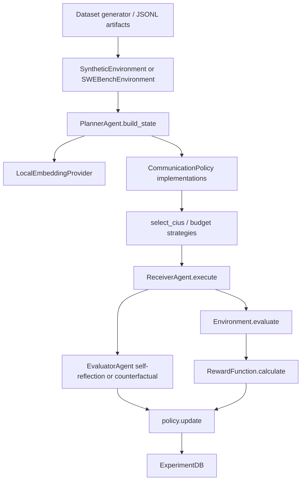

# Implementation Architecture Audit

## Components

Component: Planner. File: `src/caps/agents/planner.py:41`. Class: `PlannerAgent`. Function: `build_state`, `plan_with_llm`. Input: task string, CIUs, budget, metadata. Output: `CommunicationState` or `PlannerOutput`. Purpose: embed task/CIUs and construct policy state; LLM planning exists for raw context but the experiment runner uses `build_state`.

Component: Receiver. File: `src/caps/agents/receiver.py:40`. Class: `ReceiverAgent`. Function: `execute`. Input: task and selected CIUs only. Output: `ReceiverOutput`. Purpose: solve task using selected context and self-report used CIUs/missing info.

Component: Evaluator. File: `src/caps/agents/evaluator.py:21`. Class: `EvaluatorAgent`. Functions: `evaluate_voi`, `evaluate_self_reflection`. Input: selected CIUs, receiver output, success, environment. Output: per-CIU VOI scores. Purpose: provide policy update signal.

Component: CIU schema. File: `src/caps/communication/ciu.py:17`. Class: `CIU`. Input/Output: Pydantic object. Purpose: represent atomic context.

Component: State/action. File: `src/caps/communication/state.py:20`. Classes: `CommunicationState`, `Action`. Purpose: policy observation and selected CIU IDs/scores.

Component: LinUCB. File: `src/caps/bandits/linucb.py:47`. Class: `LinUCBPolicy`. Purpose: CAPS learning policy.

Component: Reward. File: `src/caps/evaluation/reward.py:24`. Class: `RewardFunction`. Purpose: task success minus weighted normalized communication cost.

Component: Database. File: `src/caps/storage/database.py:37`. Classes: SQLAlchemy records and `ExperimentDB`. Purpose: store experiments, episodes, metrics, nominal LLM calls.

Component: API layer. File: `src/caps/llm/groq_client.py:28`. Class: `GroqProvider`. Purpose: Groq/OpenRouter-compatible chat completions, retries, rate-limit handling, key switching, model fallback.
